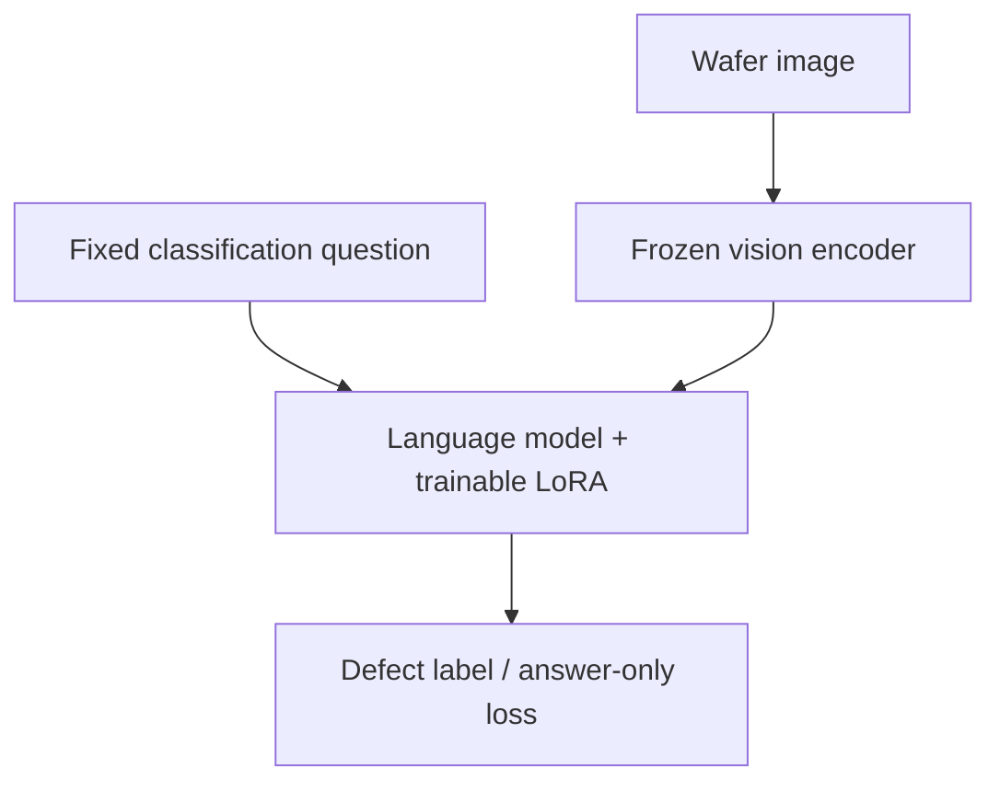

# waferVLM

**How much wafer-map classification can a 0.8B vision-language model learn from a small labeled dataset?**

waferVLM starts with [`Qwen/Qwen3.5-0.8B`](https://huggingface.co/Qwen/Qwen3.5-0.8B), comparing its original weights with a BF16, language-only LoRA adapter on the **same held-out wafer maps**. Images and a fixed classification question are the inputs; the target is a single defect label.

**Latest result:** checkpoint-200 reached **64.38% test accuracy / 0.6361 macro-F1**, with **0/160 invalid outputs**. Lowering the continuation learning rate to 5e-5 improved accuracy by **11.25 percentage points** over step 100 on the same 160 test images. Checkpoint selection used validation macro-F1. This is a single-seed development result, not a production benchmark.

**Download:** [checkpoint-200-v1 Release](https://github.com/jasonjiang8866/waferVLM/releases/tag/checkpoint-200-v1) — inference adapter, complete resumable checkpoints, raw predictions, logs and SHA256 checks. See [results, provenance and recovery instructions](docs/checkpoint-200-release.md).

**Diagnostics:** [performance evidence and recovery status](docs/checkpoint-200-diagnostics.md) — CUDA execution confirmed; the first four-step probe averaged 44.28 seconds per new optimizer step. Numerical-parity acceptance failed, and the repeat-control artifact still needs inspection after an execution-workspace outage. Both independent cleanup workflows passed; the official model remains checkpoint-200.

**Next steps:** [TODO](TODO.md) — profile the CPU/GPU bottleneck, inspect validation errors, plan a controlled 200→300 continuation, and reserve an untouched lot-level final evaluation.

| Test metric | Original model | Step 100 | Step 200 (lower LR) |
|---|---:|---:|---:|
| Accuracy | 11.88% | 53.13% | **64.38%** |
| Macro-F1 | 0.0281 | 0.5217 | **0.6361** |
| Invalid output rate | 6.88% | 0% | **0%** |

**Data:** real WM-811K, **790 training / 160 validation / 160 test images**, all eight classes, disjoint lots. Three maps with contradictory labels (six rows) are quarantined. See [data evidence](docs/data-audit.md), [validation](docs/validation.md), the [experiment protocol](docs/protocol.md) and the earlier [constant-LR control](docs/continuation-control-42431025521.md).

## What is included

- WM-811K import with source checksum verification, deterministic rendering, whole-lot splitting, duplicate-map isolation, and artifact auditing.
- Qwen3.5's pinned processor and model revision; answer-only loss; vision tower frozen; LoRA on language projections including Gated DeltaNet layers.
- Zero-shot evaluation, fixed-budget SFT, adapted-model evaluation, and paired accuracy / macro-F1 comparison.
- Strict output parsing: explanations, unknown labels and truncated responses count as failures.
- Training checkpoints, adapter export, gradient diagnostics, predictions, dependency/GPU metadata and checksums.
- CPU/data/container CI, a containerized worker, and pinned RunPod Broker read-only preflight with **CUDA >= 12.8** host selection. Higher host versions are allowed. A separate manually authorized GPU workflow supports baseline and checkpoint continuation with bounded runtime, verified artifacts and independent cleanup.



## Install and test

Python 3.12 is the tested runtime. Install [uv](https://docs.astral.sh/uv/) and use the committed dependency lock:

```bash
uv sync --frozen
uv run --frozen python -m unittest discover -s tests -p test_protocol.py -v

# Includes real, randomly initialized tiny Qwen3.5 forward/backward tests.
# No pretrained model weights are downloaded by these unit tests.
uv sync --frozen --extra train
uv run --frozen --extra train python -m unittest discover -s tests -v

# Downloads only pinned official processor/tokenizer files.
uv run --frozen --extra train python scripts/check_processor.py
uv run --frozen --extra train python scripts/check_training.py
```

The baseline pins Torch 2.10.0, torchvision 0.25.0, Transformers 5.3.0, PEFT 0.18.1 and Accelerate 1.12.0. CUDA runs require a compatible NVIDIA driver and BF16-capable GPU; the first real MIG 24GB smoke passed with approximately 2.10 GiB peak training allocation. Optional DeltaNet acceleration libraries are not installed in the initial baseline; the PyTorch fallback is slower and must be reported as such.

## Prepare WM-811K

The reproducible recipe uses the public [qingyi WM-811K Kaggle mirror](https://www.kaggle.com/datasets/qingyi/wm811k-wafer-map), with archive and `LSWMD.pkl` SHA256 checks pinned in source. NVIDIA points to [MIR Lab](https://mirlab.org/dataSet/public/); that endpoint was unavailable, so this mirror is explicitly recorded as the source. The Kaggle listing labels the mirror CC0; that does not independently establish the original dataset's rights. See [provenance and exact hashes](docs/data-audit.md). Raw data and images are not committed to Git.

**Pickle loading can execute code.** Verify the file's provenance before explicitly opting in. A checksum identifies the bytes; computing your own checksum does not establish trust.

```bash
# Downloads ~157 MB; extracts ~2.1 GB. Reserve ~3 GB disk and several GB RAM.
# Fixed seed/caps, with explicit recipe-level quarantine of conflicting labels.
uv run --frozen python scripts/prepare_public_data.py \
  --trust-pickle --output data/wm811k-lot17
uv run --frozen wafervlm audit --dataset data/wm811k-lot17

# Alternatively import another trusted file (conflicting labels fail by default).
sha256sum /path/to/WM811K.pkl
uv run --frozen wafervlm prepare \
  --source /path/to/WM811K.pkl \
  --sha256 YOUR_VERIFIED_64_CHARACTER_SHA256 \
  --trust-pickle --seed 17 --train-cap 100 --eval-cap 20 \
  --output data/custom-lot17
```

The eight labels are `center`, `donut`, `edge-loc`, `edge-ring`, `loc`, `near-full`, `random`, and `scratch`. Normal (`none`) and unlabeled samples are excluded from this initial **closed-set** protocol. It cannot establish normal-wafer false-alarm rates or unknown-defect detection.

Each split requires every class. The 100/20/20 limits are **caps**, not promised counts: the real `near-full` training count is 90. Inspect `dataset.json` for actual counts. If a class is absent, preparation fails; do not move individual images between splits to make counts fit. The generic importer defaults to rejecting contradictory labels. Its explicit `--conflict-policy exclude` option removes **all** copies of each conflicting target-class map, recording them in checksummed `quarantine.jsonl`; the pinned public recipe uses this declared policy. Remaining identical raw maps connect their lots before splitting. Rendered-image collisions across splits also cause the audit to fail.

This protocol deliberately differs from NVIDIA's small demonstration split. Scores are **not directly comparable** to its reported 96.8%.

## Train and compare

Run in a CUDA environment only after choosing an authorized compute budget:

```bash
# Eight optimizer steps; validation split only; checks the execution chain.
uv run --frozen --extra train python scripts/run_experiment.py \
  --dataset data/wm811k-lot17 --profile smoke \
  --timeout-seconds 1800 --output outputs/smoke-17

# Predeclared 100-step baseline, effective batch size 8, seed 17.
uv run --frozen --extra train python scripts/run_experiment.py \
  --dataset data/wm811k-lot17 --profile baseline \
  --timeout-seconds 3600 --output outputs/baseline-17
```

Individual stages are available through `wafervlm evaluate`, `train` and `compare`; use `--help`. The `--device cpu` option is for compatibility/debugging, not a throughput baseline. Outputs must use a new directory to prevent accidental overwrites. Saved Trainer checkpoints include optimizer, scheduler and RNG state; `train --resume-from` restores the full state. See the [released checkpoint recovery example](docs/checkpoint-200-release.md#recover-the-full-training-state). Never use an incomplete adapter export as a completed result.

`comparison/comparison.json` contains paired scores. `base/` and `tuned/` include raw responses and per-example generation times; `train/` contains adapter weights and gradient diagnostics. Latencies include the first generation and exclude model loading and image preprocessing. A completed worker is **not** a quality acceptance decision. Test-set results must not drive hyperparameter tuning.

## RunPod

See [runpod/README.md](runpod/README.md) for the extended US$30 /1,100-minute total experiment authorization, per-GPU price caps, pinned published image, data verification and cleanup design. `RUNPOD_API_KEY` stays in the Actions controller; neither the training code nor the worker receives it. Host filtering uses `minCudaVersion=12.8`, never an exact 12.8 requirement. The Broker remains GET-only; the separate waferVLM controller implements the paid lifecycle. Merging code does not launch compute: the GPU workflow requires a manual dispatch, exact main SHA and an unused authorization marker. The lower-LR continuation completed step 200 and its temporary Pod deletion was independently verified. Results and full recovery files are preserved in the [checkpoint-200 Release](https://github.com/jasonjiang8866/waferVLM/releases/tag/checkpoint-200-v1). The first diagnostic raised the conservative ledger to US$5.234111 /446.513 minutes; the repeat-control cost still needs extraction. Later paid execution requires reconciliation of that repeat. See [diagnostic evidence and outstanding recovery](docs/checkpoint-200-diagnostics.md). See the [completed-run report](docs/checkpoint-200-release.md).

## References and scope

- [NVIDIA wafer-map post-training recipe](https://nvidia-cosmos.github.io/cosmos-cookbook/recipes/post_training/reason1/wafermap_classification/post_training.html): motivates the eight-class experiment; this is an independent implementation.
- [Qwen3.5-0.8B model card](https://huggingface.co/Qwen/Qwen3.5-0.8B).
- [Transformers Qwen3.5 documentation](https://huggingface.co/docs/transformers/model_doc/qwen3_5).

Wafer failure maps are not SEM photographs or automatically equivalent to inspection-coordinate scatter plots. Classification labels provide no verified process root-cause supervision. This repository trains labels, not invented contamination or equipment diagnoses.

Code: [MIT](LICENSE). Qwen weights have their own Apache-2.0 license; WM-811K retains its own data terms. The repository code license does not relicense either upstream data or model artifacts.
