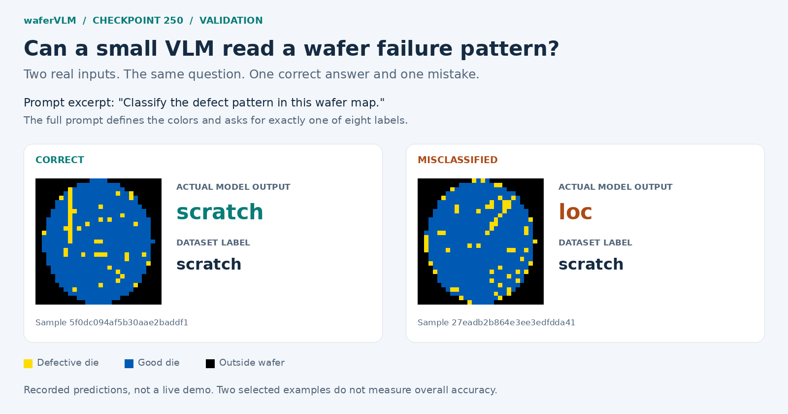
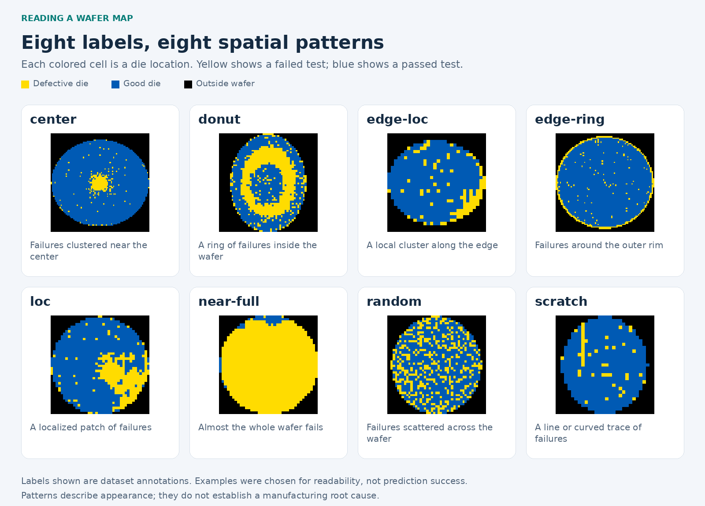
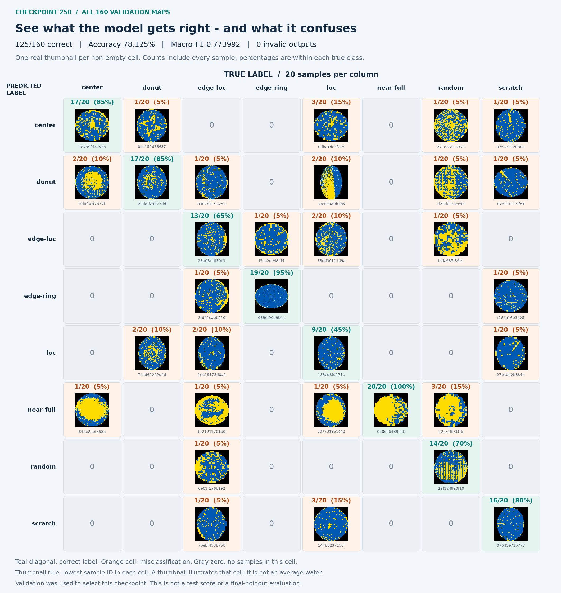
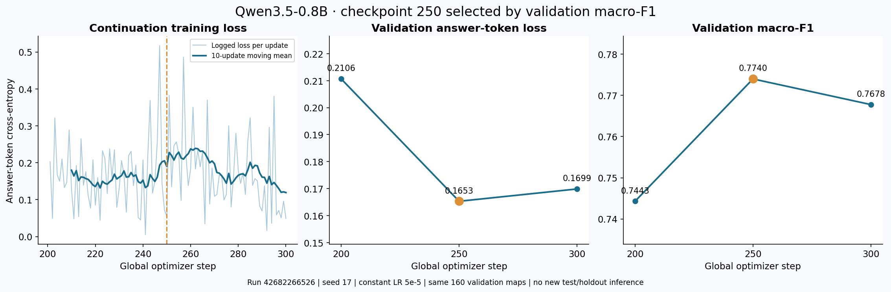
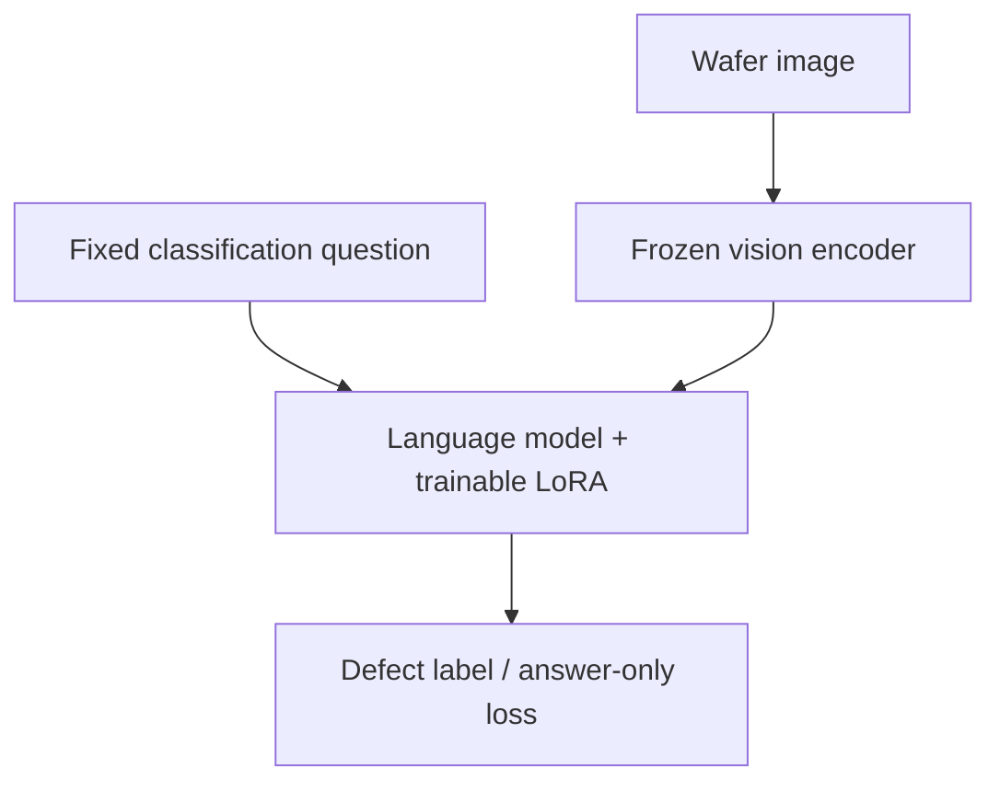

# waferVLM

**Turn wafer test maps into defect-pattern labels with a small vision-language model.**

A semiconductor wafer contains many individual chips, called **dies**. A **wafer map** records their test results at each location: **yellow = defective, blue = good, black = outside the wafer**. Failed dies can form recognizable spatial patterns, such as a ring, a local patch, or a scratch-like trace.

waferVLM gives [`Qwen/Qwen3.5-0.8B`](https://huggingface.co/Qwen/Qwen3.5-0.8B) a map and a fixed classification question, then returns one of eight pattern labels. A small LoRA adapter teaches the model this task. The current experiment classifies appearance; it does not establish the manufacturing root cause.



These are **recorded checkpoint-250 validation predictions**, including a mistake. [Inspect the full prompt, sample IDs, original predictions and reproduction steps](docs/showcase/checkpoint-250/README.md).

## Eight defect-pattern labels



The labels above are **dataset annotations**. These examples were selected for visible morphology, not prediction success. Normal (`none`) and unknown defects are outside this eight-class experiment.

## Where does the model get confused?

**125 of 160 validation maps classified correctly · 78.125% accuracy · 0.773992 macro-F1 · 0 invalid outputs.**

Read **columns as true labels** and **rows as predicted labels**. Every column contains 20 maps. Each non-empty cell shows one actual input, its full sample count and its share of that true class. The teal diagonal is correct; orange cells show mistakes. For example, **3/20 true `loc` maps were predicted `scratch`**, while **1/20 true `scratch` maps was predicted `loc`**.

[](docs/showcase/checkpoint-250/image-confusion-matrix.png)

[Open the full-size matrix](docs/showcase/checkpoint-250/image-confusion-matrix.png) · [Accessible count table and selection rules](docs/showcase/checkpoint-250/README.md#accessible-count-table) · [All 160 recorded predictions](docs/showcase/checkpoint-250/predictions.jsonl)

Counts cover the **entire validation split**, not just the displayed thumbnails. Each matrix thumbnail is the lowest sample ID in its cell. Validation was used to select this checkpoint; this showcase is **not a test or final-holdout evaluation**.

## Results and model download

**Latest development result:** validation selected **checkpoint-250** after continuing the released full checkpoint 200 to 300 at constant LR 5e-5. On the same 160 validation maps, step 250 reached **78.125% accuracy / 0.773992 macro-F1**, with **0 invalid outputs**. No new test or final-holdout inference ran. This is a single-seed development result requiring confirmation.

**Download:** [continuation-300-v1 Release](https://github.com/jasonjiang8866/waferVLM/releases/tag/continuation-300-v1) — selected inference adapter, full resumable 250/300 checkpoints, raw predictions, reports and SHA256 checks. See [results and recovery instructions](docs/continuation-300-results.md). The earlier [checkpoint-200 Release](https://github.com/jasonjiang8866/waferVLM/releases/tag/checkpoint-200-v1) remains available.

| Same 160 validation maps | Step 200 re-evaluated | Step 250 selected | Step 300 |
|---|---:|---:|---:|
| Accuracy | 75.000% | 78.125% | 78.750% |
| Macro-F1 | 0.744294 | **0.773992** | 0.767765 |
| Answer-token loss | 0.210619 | **0.165309** | 0.169867 |
| Invalid outputs | 0/160 | 0/160 | 0/160 |



The unchanged step-200 adapter changed five predictions relative to its historical GPU/host run. That cross-run macro-F1 difference (0.026833) is similar to the continuation gain (0.029697); this does not yet establish a robust improvement. The historical **64.375% test accuracy / 0.636059 macro-F1** belongs to checkpoint 200 only, not checkpoint 250 or 300.

**Diagnostics:** [recovered performance evidence](docs/checkpoint-200-diagnostics.md) and [preserved diagnostic Release](https://github.com/jasonjiang8866/waferVLM/releases/tag/checkpoint-200-diagnostics-v1). CUDA execution is confirmed. Two unprofiled four-step probes on RTX 4090 averaged 12.82/12.98 seconds per new optimizer step; both diagnostic runs remain rejected under the original numerical-parity gate. Repeated unprofiled runs also vary. No diagnostic weights are promoted.

**Next steps:** [TODO](TODO.md) and the [seed confirmation plan](docs/seed-confirmation-plan.md) — compare fixed steps 200/250 across independent seeds and repeated fixed-weight evaluation, then assess the frozen 148-image unseen-lot holdout once the models are fixed. These next experiments have not run.

**Historical test results (through checkpoint 200):**

| Test metric | Original model | Step 100 | Step 200 (lower LR) |
|---|---:|---:|---:|
| Accuracy | 11.88% | 53.13% | **64.38%** |
| Macro-F1 | 0.0281 | 0.5217 | **0.6361** |
| Invalid output rate | 6.88% | 0% | **0%** |

**Data:** real WM-811K, **790 training / 160 validation / 160 test images**, all eight classes, disjoint lots. Three maps with contradictory labels (six rows) are quarantined. See [data evidence](docs/data-audit.md), [validation](docs/validation.md), the [experiment protocol](docs/protocol.md) and the earlier [constant-LR control](docs/continuation-control-42431025521.md).

## What is included

- [DINOv3 visual comparison](docs/dinov3-baseline.md): frozen linear probe and vision LoRA, fixed-data validation, three-seed summaries, and paired wafer-map visualizations. Implementation available; pretrained DINOv3/GPU results are **not run**.
- WM-811K import with source checksum verification, deterministic rendering, whole-lot splitting, duplicate-map isolation, and artifact auditing.
- Qwen3.5's pinned processor and model revision; answer-only loss; vision tower frozen; LoRA on language projections including Gated DeltaNet layers.
- Zero-shot evaluation, fixed-budget SFT, adapted-model evaluation, and paired accuracy / macro-F1 comparison.
- Strict output parsing: explanations, unknown labels and truncated responses count as failures.
- Training checkpoints, adapter export, gradient diagnostics, predictions, dependency/GPU metadata and checksums.
- CPU/data/container CI, a containerized worker, and pinned RunPod Broker read-only preflight with **CUDA >= 12.8** host selection. Higher host versions are allowed. A separate manually authorized GPU workflow supports baseline and checkpoint continuation with bounded runtime, verified artifacts and independent cleanup.



## Install and test

Python 3.12 is the tested runtime. Install [uv](https://docs.astral.sh/uv/) and use the committed dependency lock:

```bash
uv sync --frozen
uv run --frozen python -m unittest discover -s tests -p test_protocol.py -v

# Includes real, randomly initialized tiny Qwen3.5 forward/backward tests.
# No pretrained model weights are downloaded by these unit tests.
uv sync --frozen --extra train
uv run --frozen --extra train python -m unittest discover -s tests -v

# Downloads only pinned official processor/tokenizer files.
uv run --frozen --extra train python scripts/check_processor.py
uv run --frozen --extra train python scripts/check_training.py
```

The baseline pins Torch 2.10.0, torchvision 0.25.0, Transformers 5.3.0, PEFT 0.18.1 and Accelerate 1.12.0. CUDA runs require a compatible NVIDIA driver and BF16-capable GPU; the first real MIG 24GB smoke passed with approximately 2.10 GiB peak training allocation. Optional DeltaNet acceleration libraries are not installed in the initial baseline; the PyTorch fallback is slower and must be reported as such.

## Prepare WM-811K

The reproducible recipe uses the public [qingyi WM-811K Kaggle mirror](https://www.kaggle.com/datasets/qingyi/wm811k-wafer-map), with archive and `LSWMD.pkl` SHA256 checks pinned in source. NVIDIA points to [MIR Lab](https://mirlab.org/dataSet/public/); that endpoint was unavailable, so this mirror is explicitly recorded as the source. The Kaggle listing labels the mirror CC0; that does not independently establish the original dataset's rights. See [provenance and exact hashes](docs/data-audit.md). The full raw dataset and per-sample image directories are not committed; the showcase includes selected visual excerpts and the released validation predictions.

**Pickle loading can execute code.** Verify the file's provenance before explicitly opting in. A checksum identifies the bytes; computing your own checksum does not establish trust.

```bash
# Downloads ~157 MB; extracts ~2.1 GB. Reserve ~3 GB disk and several GB RAM.
# Fixed seed/caps, with explicit recipe-level quarantine of conflicting labels.
uv run --frozen python scripts/prepare_public_data.py \
  --trust-pickle --output data/wm811k-lot17
uv run --frozen wafervlm audit --dataset data/wm811k-lot17

# Alternatively import another trusted file (conflicting labels fail by default).
sha256sum /path/to/WM811K.pkl
uv run --frozen wafervlm prepare \
  --source /path/to/WM811K.pkl \
  --sha256 YOUR_VERIFIED_64_CHARACTER_SHA256 \
  --trust-pickle --seed 17 --train-cap 100 --eval-cap 20 \
  --output data/custom-lot17
```

The eight labels are `center`, `donut`, `edge-loc`, `edge-ring`, `loc`, `near-full`, `random`, and `scratch`. Normal (`none`) and unlabeled samples are excluded from this initial **closed-set** protocol. It cannot establish normal-wafer false-alarm rates or unknown-defect detection.

Each split requires every class. The 100/20/20 limits are **caps**, not promised counts: the real `near-full` training count is 90. Inspect `dataset.json` for actual counts. If a class is absent, preparation fails; do not move individual images between splits to make counts fit. The generic importer defaults to rejecting contradictory labels. Its explicit `--conflict-policy exclude` option removes **all** copies of each conflicting target-class map, recording them in checksummed `quarantine.jsonl`; the pinned public recipe uses this declared policy. Remaining identical raw maps connect their lots before splitting. Rendered-image collisions across splits also cause the audit to fail.

This protocol deliberately differs from NVIDIA's small demonstration split. Scores are **not directly comparable** to its reported 96.8%.

## Train and compare

Run in a CUDA environment only after choosing an authorized compute budget:

```bash
# Eight optimizer steps; validation split only; checks the execution chain.
uv run --frozen --extra train python scripts/run_experiment.py \
  --dataset data/wm811k-lot17 --profile smoke \
  --timeout-seconds 1800 --output outputs/smoke-17

# Predeclared 100-step baseline, effective batch size 8, seed 17.
uv run --frozen --extra train python scripts/run_experiment.py \
  --dataset data/wm811k-lot17 --profile baseline \
  --timeout-seconds 3600 --output outputs/baseline-17
```

Individual stages are available through `wafervlm evaluate`, `train` and `compare`; use `--help`. The `--device cpu` option is for compatibility/debugging, not a throughput baseline. Outputs must use a new directory to prevent accidental overwrites. Saved Trainer checkpoints include optimizer, scheduler and RNG state; `train --resume-from` restores the full state. See the [released checkpoint recovery example](docs/checkpoint-200-release.md#recover-the-full-training-state). Never use an incomplete adapter export as a completed result.

`comparison/comparison.json` contains paired scores. `base/` and `tuned/` include raw responses and per-example generation times; `train/` contains adapter weights and gradient diagnostics. Latencies include the first generation and exclude model loading and image preprocessing. A completed worker is **not** a quality acceptance decision. Test-set results must not drive hyperparameter tuning.

## RunPod

See [runpod/README.md](runpod/README.md) for the extended US$30 /1,100-minute total experiment authorization, per-GPU price caps, pinned published image, data verification and cleanup design. `RUNPOD_API_KEY` stays in the Actions controller; neither the training code nor the worker receives it. Host filtering uses `minCudaVersion=12.8`, never an exact 12.8 requirement. The Broker remains GET-only; the separate waferVLM controller implements the paid lifecycle. Merging code does not launch compute: the GPU workflow requires a manual dispatch, exact main SHA and an unused authorization marker. The lower-LR continuation completed step 200 and its temporary Pod deletion was independently verified. Results and full recovery files are preserved in the [checkpoint-200 Release](https://github.com/jasonjiang8866/waferVLM/releases/tag/checkpoint-200-v1). After both diagnostics and the completed 200→300 continuation, conservative cumulative usage is **US$5.903039 / 491.911 minutes** within **US$30 / 1,100 minutes**. The continuation Pod is verified absent by primary and independent cleanup. See the [latest cost and cleanup evidence](docs/continuation-300-results.md#cleanup-and-cost-ledger). The consumed authorization marker remains guarded; publishing results does not launch compute.

## References and scope

- [NVIDIA wafer-map post-training recipe](https://nvidia-cosmos.github.io/cosmos-cookbook/recipes/post_training/reason1/wafermap_classification/post_training.html): motivates the eight-class experiment; this is an independent implementation.
- [Qwen3.5-0.8B model card](https://huggingface.co/Qwen/Qwen3.5-0.8B).
- [Transformers Qwen3.5 documentation](https://huggingface.co/docs/transformers/model_doc/qwen3_5).

Wafer failure maps are not SEM photographs or automatically equivalent to inspection-coordinate scatter plots. Classification labels provide no verified process root-cause supervision. This repository trains labels, not invented contamination or equipment diagnoses.

Code: [MIT](LICENSE). Qwen weights have their own Apache-2.0 license; WM-811K retains its own data terms. The repository code license does not relicense either upstream data or model artifacts.

