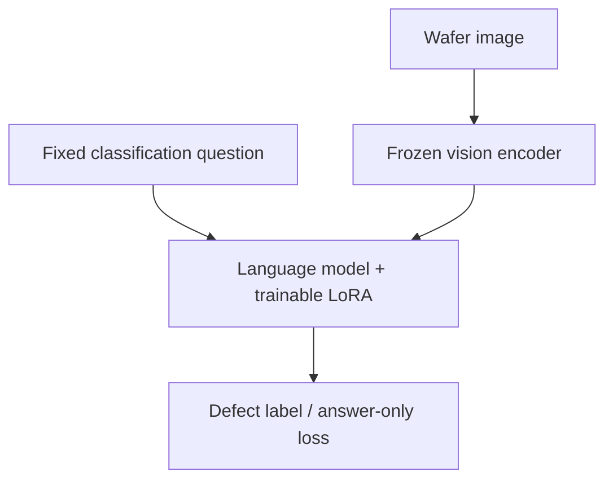

# waferVLM

**How much wafer-map classification can a 0.8B vision-language model learn from a small labeled dataset?**

waferVLM starts with [`Qwen/Qwen3.5-0.8B`](https://huggingface.co/Qwen/Qwen3.5-0.8B), comparing its original weights with a BF16, language-only LoRA adapter on the **same held-out wafer maps**. Images and a fixed classification question are the inputs; the target is a single defect label.

**Status:** initial implementation and CPU compatibility tests. No real WM-811K training result, CUDA qualification, published adapter, or production accuracy claim yet. See [validation](docs/validation.md) and the [experiment protocol](docs/protocol.md).

## What is included

- WM-811K import with source checksum verification, deterministic rendering, whole-lot splitting, duplicate-map isolation, and artifact auditing.
- Qwen3.5's pinned processor and model revision; answer-only loss; vision tower frozen; LoRA on language projections including Gated DeltaNet layers.
- Zero-shot evaluation, fixed-budget SFT, adapted-model evaluation, and paired accuracy / macro-F1 comparison.
- Strict output parsing: explanations, unknown labels and truncated responses count as failures.
- Training checkpoints, adapter export, gradient diagnostics, predictions, dependency/GPU metadata and checksums.
- CPU CI and a containerized worker for a future authorized RunPod experiment. The worker does **not** create Pods.



## Install and test

Python 3.12 is the tested runtime. Install [uv](https://docs.astral.sh/uv/) and use the committed dependency lock:

```bash
uv sync --frozen
uv run --frozen python -m unittest discover -s tests -p test_protocol.py -v

# Includes real, randomly initialized tiny Qwen3.5 forward/backward tests.
# No pretrained model weights are downloaded by these unit tests.
uv sync --frozen --extra train
uv run --frozen --extra train python -m unittest discover -s tests -v

# Downloads only pinned official processor/tokenizer files.
uv run --frozen --extra train python scripts/check_processor.py
uv run --frozen --extra train python scripts/check_training.py
```

The baseline pins Torch 2.10.0, torchvision 0.25.0, Transformers 5.3.0, PEFT 0.18.1 and Accelerate 1.12.0. CUDA runs require a compatible NVIDIA driver and BF16-capable GPU; actual GPU compatibility and memory consumption still require smoke testing. Optional DeltaNet acceleration libraries are not installed in the initial baseline; the PyTorch fallback is slower and must be reported as such.

## Prepare WM-811K

Obtain `WM811K.pkl` from a source you trust and record its source and applicable terms. NVIDIA points to [MIR Lab](https://mirlab.org/dataSet/public/); this endpoint was unavailable during initial implementation. This repository does not redistribute raw data or silently substitute an unverified mirror.

**Pickle loading can execute code.** Verify the file's provenance before explicitly opting in. A checksum identifies the bytes; computing your own checksum does not establish trust.

```bash
sha256sum /path/to/WM811K.pkl
uv run --frozen wafervlm prepare \
  --source /path/to/WM811K.pkl \
  --sha256 YOUR_VERIFIED_64_CHARACTER_SHA256 \
  --trust-pickle --seed 17 --train-cap 100 --eval-cap 20 \
  --output data/wm811k-lot17
uv run --frozen wafervlm audit --dataset data/wm811k-lot17
```

The eight labels are `center`, `donut`, `edge-loc`, `edge-ring`, `loc`, `near-full`, `random`, and `scratch`. Normal (`none`) and unlabeled samples are excluded from this initial **closed-set** protocol. It cannot establish normal-wafer false-alarm rates or unknown-defect detection.

Each split requires every class. The 100/20/20 limits are **caps**, not promised counts: lot isolation takes priority over balancing. Inspect `dataset.json` for actual counts. If a class is absent, preparation fails; do not move individual images between splits to make counts fit. Identical raw maps connect their lots before splitting. Rendered-image collisions across splits also cause the audit to fail.

This protocol deliberately differs from NVIDIA's small demonstration split. Scores are **not directly comparable** to its reported 96.8%.

## Train and compare

Run in a CUDA environment only after choosing an authorized compute budget:

```bash
# Eight optimizer steps; validation split only; checks the execution chain.
uv run --frozen --extra train python scripts/run_experiment.py \
  --dataset data/wm811k-lot17 --profile smoke \
  --timeout-seconds 1800 --output outputs/smoke-17

# Predeclared 100-step baseline, effective batch size 8, seed 17.
uv run --frozen --extra train python scripts/run_experiment.py \
  --dataset data/wm811k-lot17 --profile baseline \
  --timeout-seconds 3600 --output outputs/baseline-17
```

Individual stages are available through `wafervlm evaluate`, `train` and `compare`; use `--help`. The `--device cpu` option is for compatibility/debugging, not a throughput baseline. Outputs must use a new directory to prevent accidental overwrites. Saved Trainer checkpoints include optimizer state for inspection/recovery, but this first CLI does not yet expose resume. Never use an incomplete adapter export as a completed result.

`comparison/comparison.json` contains paired scores. `base/` and `tuned/` include raw responses and per-example generation times; `train/` contains adapter weights and gradient diagnostics. Latencies include the first generation and exclude model loading and image preprocessing. A completed worker is **not** a quality acceptance decision. Test-set results must not drive hyperparameter tuning.

## RunPod

See [runpod/README.md](runpod/README.md). `RUNPOD_API_KEY` stays in GitHub Actions Secrets. Neither the training code nor the worker receives it. This initial PR prepares the workload and image-build workflow; a provision/monitor/collect/delete controller must be integrated and reviewed before paid launch. Merging this code does not launch compute.

## References and scope

- [NVIDIA wafer-map post-training recipe](https://nvidia-cosmos.github.io/cosmos-cookbook/recipes/post_training/reason1/wafermap_classification/post_training.html): motivates the eight-class experiment; this is an independent implementation.
- [Qwen3.5-0.8B model card](https://huggingface.co/Qwen/Qwen3.5-0.8B).
- [Transformers Qwen3.5 documentation](https://huggingface.co/docs/transformers/model_doc/qwen3_5).

Wafer failure maps are not SEM photographs or automatically equivalent to inspection-coordinate scatter plots. Classification labels provide no verified process root-cause supervision. This repository trains labels, not invented contamination or equipment diagnoses.

Code: [MIT](LICENSE). Qwen weights have their own Apache-2.0 license; WM-811K retains its own data terms. The repository code license does not relicense either upstream data or model artifacts.
