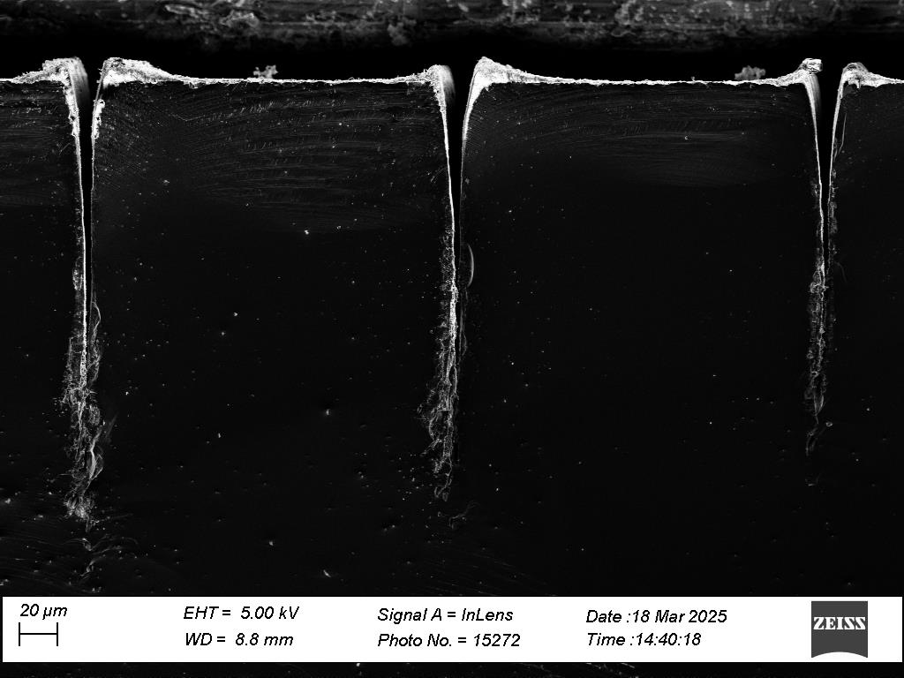

# Silicon wafer SEM example

Unmodified `Figure_1c_raw_image.png` from Sutinen, Golovleva, Liu, Patana, Timperi, Mustonen, Vähänissi and Savin, *Dataset for “Non-disruptive HF pretreatment to enhance defect visibility in silicon wafer manufacturing via photoluminescence imaging”*.

Source and citation: https://doi.org/10.5281/zenodo.19603335. License: [CC-BY-4.0](https://creativecommons.org/licenses/by/4.0/), [legal code](https://creativecommons.org/licenses/by/4.0/legalcode). This third-party image is not under the repository's MIT code license. No endorsement is implied.

[Original size and SHA256](manifest.json). This is a published SEM cross-section illustration, not a labeled wafer-defect training set. The complete PL/SEM/CSV collection is available through the downloader.
