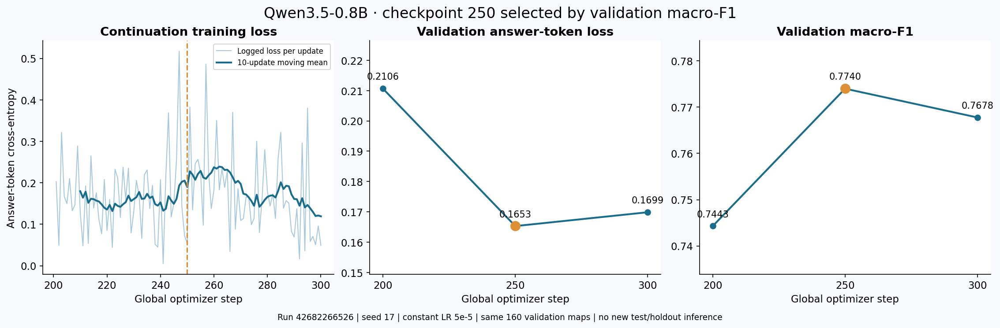
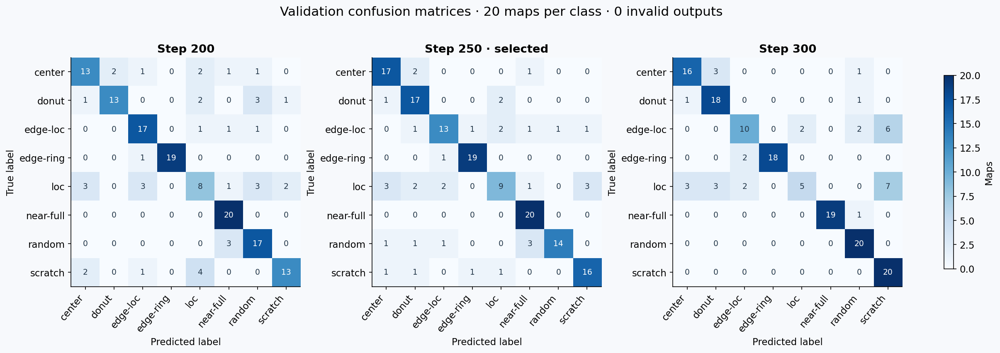
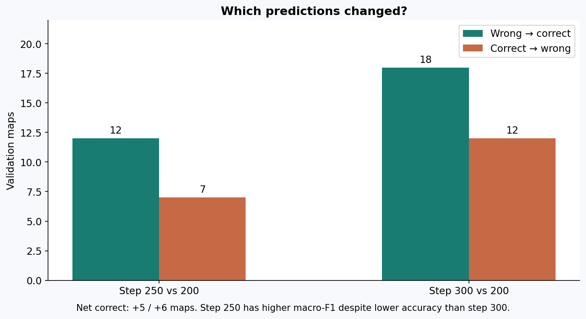

# Step-200 →300 validation-only continuation

Completed and Pod absence verified **2026-11-10 03:54:49 SGT** in
[run 42682266526](https://github.com/jasonjiang8866/waferVLM/actions/runs/42682266526).
Validation selected **checkpoint-250**. Macro-F1 changed by **+0.029697**, and accuracy by **+3.125 percentage points**, relative to the re-evaluated checkpoint-200. Selection used validation macro-F1, with ties going to the earlier step.
This is an exploratory single-seed result. **No test or final-holdout inference ran.**

## Measured results

| Same 160 validation images | Step 200 (re-evaluated) | Step 250 | Step 300 |
|---|---:|---:|---:|
| Accuracy | 75.000% | 78.125% | 78.750% |
| Macro-F1 | 0.744294 | 0.773992 | 0.767765 |
| Answer-token loss | 0.210619 | 0.165309 | 0.169867 |
| Invalid outputs | 0/160 | 0/160 | 0/160 |
| Mean generation seconds / image | 0.4193 | 0.4126 | 0.4265 |
| Peak evaluation allocation (GiB) | 1.984 | 1.984 | 1.984 |

All 480 prediction records were checked against the same 160 unique IDs, labels
and rendered-image hashes; classification metrics were independently recomputed.
Loss is answer-token cross-entropy, weighted by answer-token count. Generation
timing excludes model loading and preprocessing, and includes the first image.



The historical checkpoint-200 validation record had accuracy 72.500%, macro-F1
0.717461 and answer-token loss 0.211074. Re-evaluation changed
**5/160 predicted labels** and
**5/160 raw responses**. Adapter and manifest hashes
match; GPU/host differ, so this is not an isolated hardware-effect experiment.
Use the current run's checkpoint-200 as the reference for its continuation.
The cross-run F1 difference (0.026833) is similar in size to this continuation's
within-run gain (0.029697). This limits confidence in interpreting a single-run
gain as a robust improvement; independent seeds and repeated fixed-weight
evaluations are the next checks.
The historical test score remains 64.375% /0.636059 for checkpoint-200 only;
it is not a test score for the newly trained checkpoints.

## Changes by class and sample

| True label (20 images each) | Recall at 200 | Recall at 250 | Recall at 300 |
|---|---:|---:|---:|
| center | 13/20 | 17/20 | 16/20 |
| donut | 13/20 | 17/20 | 18/20 |
| edge-loc | 17/20 | 13/20 | 10/20 |
| edge-ring | 19/20 | 19/20 | 18/20 |
| loc | 8/20 | 9/20 | 5/20 |
| near-full | 20/20 | 20/20 | 19/20 |
| random | 17/20 | 14/20 | 20/20 |
| scratch | 13/20 | 16/20 | 20/20 |

| Comparison with 200 | Wrong → correct | Correct → wrong | Both correct | Both wrong |
|---|---:|---:|---:|---:|
| Step 250 | 12 | 7 | 113 | 28 |
| Step 300 | 18 | 12 | 108 | 22 |

Step 250 improves center/donut recall from 65% to 85% and scratch from 65% to 80%,
while edge-loc falls from 85% to 65% and random from 85% to 70%. At step 300,
scratch/random reach 100% recall, but loc falls to 25% and edge-loc to 50%.
This class tradeoff explains why the highest accuracy does not coincide with
the highest macro-F1. The extra 50 steps from 250 to 300 do not improve the
predeclared selection criterion; both validation loss and segment mean training
loss rise slightly. These observations alone do not establish an overfitting cause.





Each class has only 20 validation examples; one changed prediction moves its
recall by five percentage points. `changed-predictions.json` in the evidence
package lists every changed sample ID and old/new prediction. These development
results do not establish independent-lot generalization or seed stability.

## Training and runtime

| New updates | Mean logged training loss | Trainer runtime | Seconds / new optimizer step | Peak allocation |
|---|---:|---:|---:|---:|
| 201–250 | 0.163632 | 610.92s | 12.218s | 2.138 GiB |
| 251–300 | 0.176113 | 615.34s | 12.307s | 2.138 GiB |

Both segments restored full adapter, AdamW moments and step counts, scheduler,
RNG and Trainer state: **200→250→300**. All **100** new gradient checks were
finite and nonzero, and every actual optimizer LR was **5e-5**. Both full states
are retained. No LR intervention, optimizer reset, profiler, kernel change or
thread-setting change was introduced.

GPU: **NVIDIA GeForce RTX 4090**, region **EUR-IS-1**, observed rate
**US$0.89/hour**. Pod lifecycle bound, from creation
intent through verified absence, was **34.911 minutes**, including startup,
data, three validation passes, result retrieval and cleanup. Training runtime
above is divided by 50 *new* updates, avoiding Trainer's cumulative-step denominator.
Peak allocation is PyTorch allocated tensor memory, not the full reserved/device
memory or RunPod utilization gauge.

The earlier diagnostic parity failures remain rejected and preserved in the
[diagnostic report](https://github.com/jasonjiang8866/waferVLM/blob/main/docs/checkpoint-200-diagnostics.md). This continuation used the
unchanged unprofiled path; it does not certify numerical equivalence of repeats
or an acceleration change.

## Download, verify and restore

[Release continuation-300-v1](https://github.com/jasonjiang8866/waferVLM/releases/tag/continuation-300-v1)
preserves this experiment outside Actions retention. It is a **pre-release**:
validation-selected research evidence, not production qualification.

| Asset | Purpose |
|---|---|
| `wafervlm-run-42682266526.zip` | Unmodified full Actions package with both resumable checkpoints, raw predictions, logs and primary cleanup evidence |
| `wafervlm-validation-evidence.tar.gz` | Independent inspection, recomputed metrics, changed IDs, plots and independent cleanup evidence |
| `release-manifest.json` | Exact metrics, source/image identities, artifact hashes and cost evidence |
| `MODEL_CARD.md` | Standalone report, scope and use instructions |
| `SHA256SUMS` | Checksums of the published assets |
| `wafervlm-qwen3.5-0.8b-step250-adapter.tar.gz` | Validation-selected inference adapter, processor/tokenizer and original metadata |

Download the assets together and verify before extraction:

```bash
sha256sum -c SHA256SUMS
mkdir recovered-run-42682266526
unzip wafervlm-run-42682266526.zip -d recovered-run-42682266526
tar -xzf recovered-run-42682266526/experiment.tar.gz -C recovered-run-42682266526
```

Full resumable states are below
`recovered-run-42682266526/results/extension/step250/checkpoints/checkpoint-250`
and `.../step300/checkpoints/checkpoint-300`. Keep each full `step250`/`step300`
directory together, including its metadata and manifests. Serialized optimizer
and RNG state must be loaded only from this trusted, hash-verified release.
The compact inference archive alone is not sufficient for training resume.

For inference, use the locked environment and the same audited dataset protocol:

```bash
tar -xzf wafervlm-qwen3.5-0.8b-step250-adapter.tar.gz
uv sync --frozen --extra train
uv run --frozen --extra train wafervlm evaluate \
  --dataset data/wm811k-lot17 --adapter checkpoint-250/adapter \
  --split validation --device cuda --output outputs/released-250-validation
```

The compact package preserves every adapter file and `run.json`/`training.json`
byte-for-byte. `source-checksums.json` retains the original full manifest; its
new `checksums.json` covers the packaged files. Every packaged file and the
completed compressed archive was re-opened and checked locally. Packaging did
not constitute an additional GPU inference run.

## Exact provenance and acceptance

- Controller/main at launch: `eee786b1c1609a6a7498c4c43e66e29ab260143b`.
- Worker source: `064a37fa828ca0fa4ce106bfce46db3da48d8e5b`.
- Worker image: `ghcr.io/jasonjiang8866/wafervlm@sha256:b13a9807ae05698f0813e0d1ab7f25548e782f65729d2b2aec5e66de6de24cd1`.
- Base: `Qwen/Qwen3.5-0.8B`, revision `2fc06364715b967f1860aea9cf38778875588b17`.
- Parent: full `checkpoint-200-v1`, original run `42502913001`, verified during image build and on resume.
- Parent adapter SHA256: `8cda3bcfcacdb62a4f6649d17fa415749af01aedd663986322fa7550ed328c55`.
- Dataset SHA256: `c588b3ef59d9dba57cfc745ec20db903e6ff2dcc75504112348f8b9f1ad3ab68`.
- Validation manifest SHA256: `3243e450163721eecac5ce5f4667f9a93599674337fed46e5e40ddeb940ab54f`.
- Result ZIP SHA256: `32024461ade6dcd34398e96a78b537c5a274e9da636ebda9a655b6618e32a250`.
- Inner archive SHA256: `79aa2a1cca663e3023ef40f1b20592f52de80529b589e71dbb3ec301614bec93`.
- Recipe: BF16 language-only LoRA r8/alpha16, frozen vision, answer-only loss,
  seed 17, batch1×accumulation8, max length1024, constant LR 5e-5 after step 100.
- Torch 2.10.0/CUDA 12.8, Transformers 5.3.0, PEFT 0.18.1, Accelerate 1.12.0;
  unchanged PyTorch DeltaNet fallback. Host selection accepts CUDA >=12.8.

The controller verifier and independent local inspection accepted
**64 regular files / 236,169,969 unpacked bytes**.
Checks include archive safety, nested hashes, data/model/source/image identity,
complete parent and 250→300 state hash chains, exact update/gradient/LR traces,
validation IDs and recomputed metrics, and the declared selection criterion.
Restricted CPU tensor loaders also checked all 372 saved AdamW states and
372 language-only LoRA tensors (5,411,328 parameters) per checkpoint: finite
moments/weights, Adam steps 250/300, scheduler epochs 250/300 and LR 5e-5.
The original diagnostic gates were not relaxed.

## Cleanup and cost ledger

Owned Pod `43bhfd177zngmx` is **verified absent**. Primary cleanup recorded
3 consecutive absence checks;
[independent cleanup run 42687904866](https://github.com/jasonjiang8866/waferVLM/actions/runs/42687904866)
separately confirmed absence. No persistent volume was created. The one-off
authorization marker for run 42682266526 was downloaded and hash-verified.

Incremental conservative cost: **US$0.523039**. Including prior upward-rounded
reserves of US$5.38 /457 minutes, cumulative conservative usage is
**US$5.903039 / 491.911 minutes**,
within the approved **US$30 /1,100 minutes**. Costs include the temporary disk
estimate; they are lifecycle estimates, not a provider invoice or hard cap.
The unreconciled authorization guard prevents another dispatch from silently
reusing this allowance. This report does not launch another paid run.

## Next decision

The [frozen 148-image final holdout](https://github.com/jasonjiang8866/waferVLM/blob/main/docs/evidence/final-holdout-v1/reservation.json)
remains unevaluated. It covers 143 duplicate-connected lot groups, with 20
images per class except near-full (8 eligible maps). Its manifest SHA256 is
`f08050ef4fcaca3b9c35ad29905a63957a375af7a024b69e0281968d06f4564f`.
Keep those groups out of any future data expansion.

The [seed confirmation plan](https://github.com/jasonjiang8866/waferVLM/blob/main/docs/seed-confirmation-plan.md) freezes step 200 vs 250
for seeds 17/42/123, with new runs still unexecuted. Do not use the historical test split
to tune steps, prompts, learning rates or kernels. Further training on this
single seed is not a substitute for checking reproducibility across seeds/lots.
Normal/unknown defects, SEM photographs and process root-cause diagnosis remain
outside this eight-label experiment.

Model and dataset terms are separate from this repository's MIT code license.
Qwen's upstream weights use Apache-2.0; the WM-811K mirror's listing does not
independently establish original dataset rights. Neither raw WM-811K data nor
base-model weights are included in these assets.

## Publication recovery

The saved review ZIP was truncated. On 2026-11-11 SGT, the original Actions result ZIP was downloaded again and matched its recorded SHA256 exactly. The selected adapter archive also matched its original hash. Validation metrics, changed-prediction records and plots were regenerated from the unchanged original evidence; `publication-recovery.json` records this reconstruction. No model inference or new GPU work was performed.
