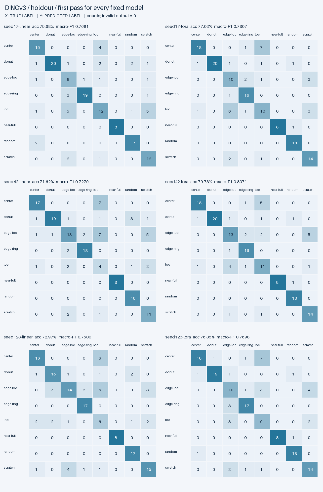

# DINOv3 on the frozen unseen-lot set

**Accepted: six fixed models, six independent inference processes, 888/888 predictions.** The [2026-11-21 run](https://github.com/jasonjiang8866/waferVLM/actions/runs/44843362544) evaluated exactly the same **148 maps / 143 lot groups** as [Qwen PR #53](https://github.com/jasonjiang8866/waferVLM/pull/53). All IDs, PNG SHA-256 values, labels, selected-weight hashes, eight-class probabilities and recorded metrics were independently checked on CPU. Local recomputation exactly reproduced the controller's acceptance report, including all four paired bootstrap comparisons.

The previously accepted validation stays **18/18 processes / 2,880 predictions**. This holdout run adds **0 validation passes, 0 training jobs, 6 holdout passes / 888 predictions**. Three inference repeats are not three training seeds; this study has three training seeds.

## Frozen before evaluation

[PR #63](https://github.com/jasonjiang8866/waferVLM/pull/63), merged as `aa33e8b949e396892764a1a7503aaadc09a95fc4` on 2026-11-19, committed [all six selected weight hashes](evidence/dinov3-six-endpoints.json), the manifests, preprocessing and statistical method before any DINO holdout prediction. This run used controller `303dcc779e5b3f7947148251d5b0815d006624e7` and the unchanged image, backbone, plan and six exports. The freeze file SHA-256 remains `1b676ad216cc437f68718ca1e592628d2b4826e97f767c4daa8ff4ab11844202`.

The Qwen holdout results were already public. This is an **additional prespecified model comparison on the same holdout**, not an independently concealed study design. No learning rate, epoch, seed, checkpoint or favorable repeat was selected from these results. Each endpoint was evaluated once; all six are reported.

## Does LoRA's gain extend beyond the development set?

| Seed | Linear accuracy | LoRA accuracy | Difference | Linear macro-F1 | LoRA macro-F1 | Difference |
|---|---:|---:|---:|---:|---:|---:|
| 17 | 112/148 (75.6757%) | 114/148 (77.0270%) | +1.3514 pp | 0.769054 | 0.780653 | +0.011599 |
| 42 | 106/148 (71.6216%) | 118/148 (79.7297%) | +8.1081 pp | 0.727930 | 0.807057 | +0.079127 |
| 123 | 108/148 (72.9730%) | 113/148 (76.3514%) | +3.3784 pp | 0.750038 | 0.769831 | +0.019793 |

The primary comparison is LoRA minus frozen-backbone linear **within each seed**. Its direction is positive for accuracy and macro-F1 in **3/3 seeds on both the 160-map development set and this 148-map holdout**. It does not improve every class.

Paired lot-group bootstrap: 10,000 resamples, RNG seed 20261110, shared group multiplicities for both models, fixed eight classes, undefined F1 = 0, percentile 95% intervals. The method is identical to Qwen's. Intervals are per comparison, without multiplicity adjustment; they describe uncertainty over these lots, not a distribution over training seeds.

| Seed | Accuracy difference: 95% interval (pp) | Macro-F1 difference: 95% interval |
|---|---:|---:|
| 17 | [−4.0268, +6.7568] | [−0.040789, +0.065070] |
| 42 | [+2.0134, +14.3836] | [+0.020785, +0.137091] |
| 123 | [−2.7027, +9.5238] | [−0.037934, +0.077529] |

Only seed 42's intervals exclude zero for both metrics. The evidence supports a repeated positive direction and a clearer improvement for that prespecified pair; it does not establish a precisely estimated benefit for every seed. Seed 42 is not selected as a new release on this basis.

**Interpretation guardrails:** Three positive training-seed contrasts are not a confidence interval over training seeds or future production lots. The reported per-contrast 95% bootstrap intervals are unadjusted for multiple comparisons; one positive seed-42 interval must not be promoted to an across-seed or family-wise significance claim. The same 148-map holdout already had public Qwen results before the frozen DINOv3 evaluation; this is a predeclared *additional model comparison*, not a new independently concealed holdout. No result-dependent seed/checkpoint selection or new performance claim follows from these diagnostics.

## Fixed seed-17 LoRA versus published Qwen step 250

| Model | Correct | Accuracy | Macro-F1 | loc recall |
|---|---:|---:|---:|---:|
| Published Qwen, seed 17 / step 250 | 104/148 | 70.2703% | 0.711854 | 50% |
| DINOv3 LoRA, seed 17 / epoch 5 | 114/148 | 77.0270% | 0.780653 | 50% |

The paired four-way counts are **91 both correct, 23 only DINO correct, 13 only Qwen correct, 21 both wrong**, totaling 148. Accuracy improves by **+6.7568 pp**, with a paired lot-group 95% interval **[−1.3245, +14.6873] pp**. Macro-F1 improves by **+0.068800**, interval **[−0.008452, +0.151392]**. Both intervals include zero. The point estimate favors DINO; a general claim of definitive architecture superiority is not supported.

DINO uses an eight-way argmax head and the original 10-epoch / 990-update / 7,900-presentation training protocol. Qwen uses its own 250-step continuation protocol, greedy text generation with up to 16 new tokens, microbatch 1 and accumulation 8. Model size, pretraining, adaptation location, output format and training compute are not matched. Zero invalid DINO labels follow from the classifier construction and are not an independent quality gain.

## Which loc maps remain difficult?

| Seed | Linear loc recall | LoRA loc recall |
|---|---:|---:|
| 17 | 12/20 (60%) | 10/20 (50%) |
| 42 | 4/20 (20%) | 11/20 (55%) |
| 123 | 6/20 (30%) | 9/20 (45%) |

Seed-17 LoRA rescues three loc maps missed by published Qwen and misses three loc maps that Qwen gets right: identical loc recall hides different per-image errors. All six DINO endpoints miss the following five holdout loc maps. These are prediction diagnostics, not morphology-based causal explanations or grounds for relabeling.

| Holdout loc ID | Qwen seed 17 / step 250 | All three linear predictions | All three LoRA predictions |
|---|---|---|---|
| `0e05d9b47d4556c6f565e697` | scratch | scratch | scratch |
| `5f5607454a3e2f6e43ed67f3` | center | center | center |
| `ddde9ea2763c8eb934a04f9d` | donut | edge-loc | center |
| `df9926478149365e6fc118b3` | loc | center | center |
| `e6aab54923abe2a8998109f9` | center | center | center |

The original **16 six-checkpoint Qwen common errors** and **7 loc common errors** belong to the development set, not this holdout. Historical seed-17 linear rescues **7/16**, LoRA **6/16**; both rescue **3/7 loc**. Across the three confirmed DINO seeds, every LoRA rescues the same six common errors and the same three loc maps. Four development loc IDs remain wrong for all six DINO models: `50773a965c423a8290e617f2`, `aac6e9a0b3b5aa660ce62121`, `be8bdd8417b86a07da6a61f2`, `c882bea412b6513af0935266`. Their reviewed visible shapes and differing labels are preserved in the [development report](dinov3-confirmation-results.md#qwens-common-errors-and-the-difficult-loc-maps) and [real-image diagnostic gallery in PR #56](https://github.com/jasonjiang8866/waferVLM/pull/56). Those ten diagnostic maps were selected by Qwen behavior; overall development metrics use all 160 maps.

## Complete predictions and confusion matrices

[All six models' metrics, class recalls, four-way counts, inference time and memory](showcase/dinov3-confirmation-holdout/README.md) · [All 148 paired rows](showcase/dinov3-confirmation-holdout/paired-per-image.csv) · [888 predictions with eight-class probabilities](showcase/dinov3-confirmation-holdout/predictions) · [Machine-readable analysis](showcase/dinov3-confirmation-holdout/analysis.json)



Each model's complete 148-map inference takes **2.086–2.940 seconds**, excluding model loading; peak PyTorch allocated memory is **122.30 MiB (linear) / 123.56 MiB (LoRA)**, not whole-device reservation. Timing includes synchronized image verification, decoding, preprocessing, transfer and forward execution, with no warmup. Qwen's earlier timing measured generation only, so a direct speed ratio would be misleading. These are single measurements on one RTX 4090, not a latency benchmark.

Training seed 17 used RTX 5090, while seeds 42/123 used RTX 4090. Each within-seed pair used the same GPU type; between-seed differences cannot isolate training randomness from hardware. All 18 new development passes and all six holdout passes used RTX 4090. The original selected-epoch seed-17 development results and separate batch-1 reload remain unchanged.

## Execution, cost and cleanup

The run allocated **RTX 4090 / US-NC-1 at US$0.89/hour**, temporary Pod `q3r326bhxixfmp`, 60 GB ephemeral disk and no persistent volume. CUDA was filtered by **minimum 12.8**, and real CUDA/BF16 execution was verified. The pinned image already contained the base backbone; only the small frozen training-export archive was delivered through a scoped input URL. Startup diagnostics observed image pulling before the worker became responsive; no retry or protocol change was needed in this attempt.

Primary cleanup confirmed **three consecutive absences**. [Independent cleanup 44844163133](https://github.com/jasonjiang8866/waferVLM/actions/runs/44844163133) confirmed **twelve**, and both workflows succeeded. The intent-to-final-primary-absence bound is **315.898412 seconds / US$0.0788806**, including temporary disk. Cumulative DINO usage, including prior failures, is **US$1.6704166 / 93.4743 minutes** against the original **US$10 / 500-minute** allowance, leaving **US$8.3295834 / 406.5257 minutes**. These are conservative lifecycle estimates, not provider invoices. No owned Pod or persistent storage remains from this run.

[Exact acceptance and cleanup receipt](evidence/dinov3-holdout-complete.json) · [Cumulative DINO ledger](../runpod/dinov3-study-ledger.json) · [Earlier failed attempts](dinov3-study-recovery.md)

- [Result artifact 14682595469](https://github.com/jasonjiang8866/waferVLM/actions/runs/44843362544/artifacts/14682595469): 2,152,945 bytes; ZIP SHA-256 `c70e48ab4e558d038ab8b39c9bdf79c3291e9e3dedf47e15f289f634efaf5402`.
- Inner `experiment.tar.gz`: 2,140,488 bytes; SHA-256 `9e9a0f3f3f0645d97235ab6c07d0b9f4e8fcc9e63d2df03c0ee9f4696d2ebc8a`.
- [Independent cleanup artifact 14682995203](https://github.com/jasonjiang8866/waferVLM/actions/runs/44844163133/artifacts/14682995203): ZIP SHA-256 `07a9544a63737ee6d90186458d028c86468deea7dcc41506bca7a2f4bffe15bf`.

Git preserves all predictions/probabilities, metrics, manifests, selected-weight hashes and cleanup receipts. The raw result artifact retains the six selected exports and run logs. **The Actions artifact expires; an independently verified durable copy is not yet recorded.** See the [retention manifest and CPU-only archival procedure](dinov3-holdout-archive.md). To reproduce the CPU report from the verified inner archive:

```bash
uv run --frozen python -m analysis.dinov3_confirmation_report \
  /path/to/unpacked/results holdout /path/to/launch-spec.json /new/output/directory
uv run --frozen python -m unittest analysis.tests.test_dinov3_confirmation_report -v
```
