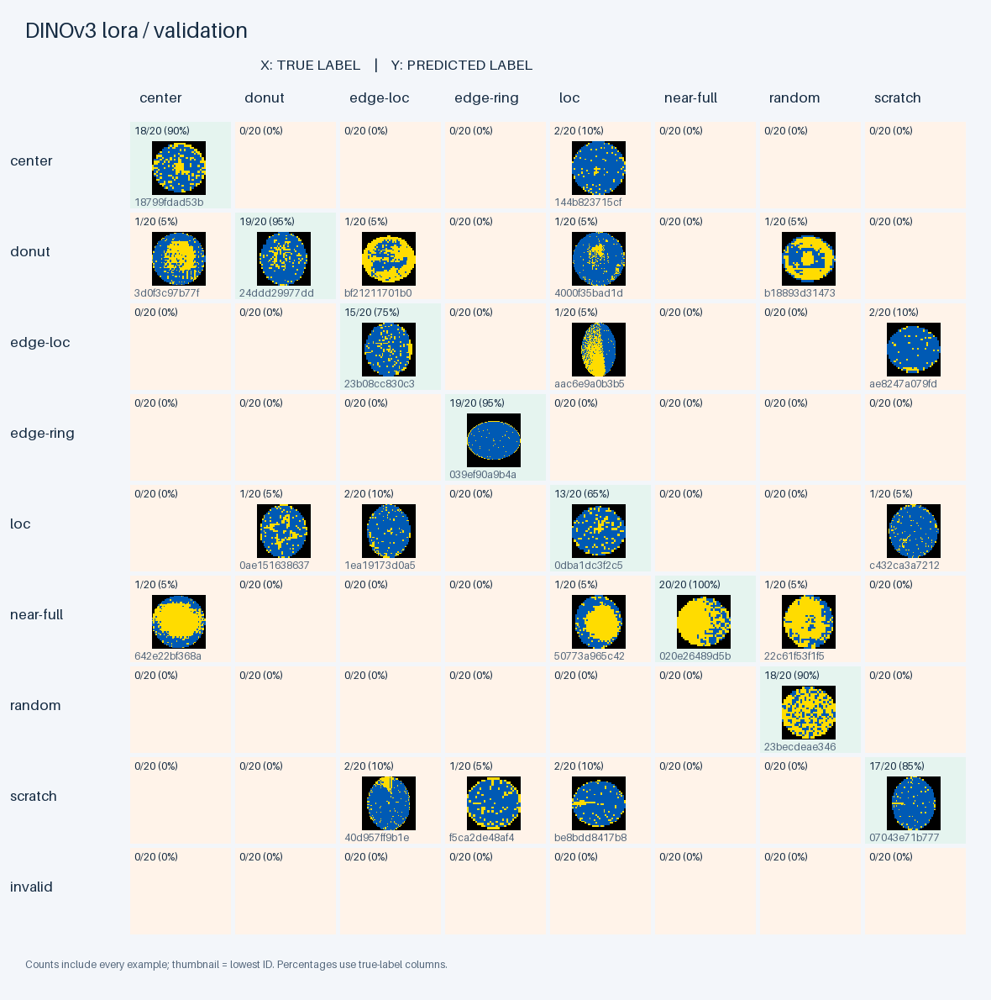

# DINOv3 seed-17 development results

Completed **2026-11-15, 21:21 Singapore time** on one RTX 5090. The six-trial sweep, selected-model reloads, artifact verification and independent Pod cleanup succeeded. Result status is **execution accepted; quality confirmation pending** (`quality_accepted: false`). This report does not promote a final model or report a test/holdout score.

- [Training run 43716864164](https://github.com/jasonjiang8866/waferVLM/actions/runs/43716864164)
- [Independent cleanup 43718558040](https://github.com/jasonjiang8866/waferVLM/actions/runs/43718558040)
- [Complete result ZIP, including selected inference heads/adapters](https://github.com/jasonjiang8866/waferVLM/actions/runs/43716864164/artifacts/14163676440) — Actions artifact retention ends 2027-02-13. Base DINOv3 weights and resumable optimizer state are not included.
- [Machine-readable evidence: six histories, recipe, provenance, cost and cleanup](evidence/dinov3-seed17-43716864164.json)
- [Wafer-map matrices, accessible counts and sample IDs](showcase/dinov3-seed17/README.md)

## Same-validation comparison

All scores below cover the same 160 validation maps, 20 per class. DINOv3 scores are the original selected batch-size-eight predictions; Qwen uses its recorded checkpoint-250 predictions.

| Model | Correct | Accuracy | Macro-F1 | Trainable parameters |
|---|---:|---:|---:|---:|
| Qwen3.5-0.8B checkpoint 250 | 125/160 | 78.125% | 0.773992 | Language-side LoRA; separate training recipe |
| DINOv3 frozen backbone + linear head | 134/160 | 83.750% | 0.836449 | 6,152 |
| DINOv3 Q/V LoRA + linear head | 139/160 | 86.875% | 0.867173 | 153,608 |

LoRA improves over the DINOv3 linear baseline by **3.125 accuracy percentage points and 0.030724 macro-F1**. Relative to the recorded Qwen checkpoint it improves by **8.750 points and 0.093180 macro-F1**. This does not isolate an architecture or LoRA-algorithm effect: pretrained data, model architecture, adaptation location, output head and training exposure differ. Each DINOv3 trial sees 7,900 training examples across 990 optimizer steps, while Qwen's selected checkpoint is step 250. No compute-matched or cross-model latency claim is made.

The LoRA/Qwen paired counts are **117 both correct, 22 only DINOv3 correct, 8 only Qwen correct, 13 both wrong**. The LoRA model's weakest validation class is `loc` (13/20 correct), then `edge-loc` (15/20). See the actual wafer maps rather than treating the aggregate score as uniform improvement across classes.

**X = true label; Y = predicted label.** Every map contributes to counts. Each non-empty cell shows its lowest sample ID, and percentages use the true-class column total. Eight-way argmax guarantees zero invalid labels; this is not an extra quality improvement over a generative model.

## All six declared trials

Official backbone: `facebook/dinov3-vits16-pretrain-lvd1689m`, revision `114c1379950215c8b35dfcd4e90a5c251dde0d32`. The recipe uses 790 training maps, seed 17, batch size 8, 256x256 input, FP32 parameters with BF16 autocast, AdamW, and a fixed 10-epoch budget. Each trial completed **990 optimizer updates / 7,900 example presentations**. All three LoRA runs recorded nonzero adapter gradients on **990/990** steps.

| Trial | Learning rate | Selected epoch | Accuracy | Macro-F1 | Training-process elapsed seconds |
|---|---:|---:|---:|---:|---:|
| linear-0 | 0.001 | 8 | 83.750% | 0.832040 | 95.67 |
| **linear-1** | **0.003** | **10** | **83.750%** | **0.836449** | 110.04 |
| linear-2 | 0.01 | 8 | 80.000% | 0.792307 | 109.94 |
| lora-0 | 0.00005 | 6 | 86.875% | 0.866052 | 124.38 |
| **lora-1** | **0.0001** | **5** | **86.875%** | **0.867173** | 122.07 |
| lora-2 | 0.0002 | 6 | 86.875% | 0.866365 | 118.94 |

LoRA head LR is 0.001 in all three trials; rank 8, alpha 16, Q/V targets only. Within each trial, select the highest validation macro-F1 and break ties with the earliest epoch. Between learning rates, select the highest validation macro-F1 and break ties with the lower LR. Thus **linear LR 0.003 and LoRA LR 0.0001** are the settings to freeze before confirmation seeds; seeds 42 and 123 have not run.

Elapsed times above include model setup, training and per-epoch validation inside the training function; they exclude container startup and the separate reload/visualization stages. They are not pure GPU kernel times. Training peak allocated tensor memory was 142,350,336 bytes for linear and 449,915,392 bytes for LoRA; these are not total device/process memory measurements.

For selected LoRA, training loss fell from **1.58737 to 0.09405**, but the best validation epoch was **5**, not 10. Validation macro-F1 fluctuated after that peak. The full per-epoch histories are retained; lower training loss alone does not establish better generalization.

## Reload verification and prediction changes

Both selected exports were reloaded in fresh CUDA processes, with the same base-weight and selected-weight hashes. The reload evaluator uses batch size **1**, while selection used **8**. Reload completed successfully, but predictions are not identical:

| Selected model | Selection macro-F1 | Reload macro-F1 | Selection / reload accuracy | Changed predictions |
|---|---:|---:|---:|---:|
| Linear | 0.836449 | 0.835856 | 83.750% / 83.750% | 2/160 |
| LoRA | 0.867173 | 0.867110 | 86.875% / 86.875% | 1/160 |

| Model | Sample ID | True label | Selected prediction | Reload prediction |
|---|---|---|---|---|
| Linear | `db793757b592bd3347fa57ab` | scratch | loc | scratch |
| Linear | `f5ca2de48af4e569a3ce1c2b` | edge-ring | edge-ring | center |
| LoRA | `f5ca2de48af4e569a3ce1c2b` | edge-ring | scratch | edge-loc |

The changed batch shape and fresh process are observed conditions; this run does not isolate the numerical cause. README tables and matrices consistently use the **selected** prediction set, and the separate reload predictions remain available in the existing result artifact. No exact-parity claim is made.

## Cost and cleanup

| Item | Verified receipt |
|---|---|
| Allocated GPU / region | NVIDIA GeForce RTX 5090 / EUR-IS-1 |
| GPU rate | US$1.39/hour |
| Intent-to-verified-absence runtime bound | 1,075.993593 seconds / 17.933227 minutes |
| This run's compute + temporary disk estimate | US$0.418122 |
| Three prior failed attempts, conservative accounting | US$0.23 / 690 seconds |
| Cumulative DINO estimate | US$0.648122 / 29.433227 minutes |
| Existing total authorization | US$10 / 500 minutes |
| Primary cleanup receipt | `verified_absent`, 3 checks |
| Separate cleanup workflow | `verified_absent`, 12 checks |
| Persistent volumes | None created |

Costs use the conservative interval from create intent through confirmed absence, including the 60 GB temporary disk allowance; they are **estimates, not a provider invoice**. Pre-create capacity was rechecked and the allocated EUR-IS-1 region passed that fresh gate; an earlier read-only observation had found EU-RO-1. The temporary Pod `yrgtglsec1k3kw` was verified absent, including by the independent workflow at **21:23 Singapore time**.

This publication creates no GPU resources and does not reset the consumed run marker. Another dispatch requires reconciling this completed execution with the lifecycle history; it must not reuse the old six-known-runs-plus-one gate unchanged.

## Provenance and independent verification

| Evidence | SHA256 / identity |
|---|---|
| Source commit | `c255bec677ba4b525e4997af60d9020592e15a46` |
| GHCR image | `ghcr.io/jasonjiang8866/wafervlm@sha256:d64ef98a018ce25d41add6a8c3a65225ab83f22addb16ab47959e0c5b01ab329` |
| Result ZIP, artifact 14163676440 | `6dadcd924ed96b88b8158c7dc5a09ff101c8e52db3b38cc8c7f5ebb090f24421` |
| Nested `experiment.tar.gz` | `9667744e5e93c9af486b3d5e0251a026824d0609bbe208e78571fa142b16ff09` |
| Independent cleanup ZIP, artifact 14163821365 | `8de8ec66d6ddd678e9a7629bbadf9c340a50cf0c7c0abc2565c2d7690b3218de` |
| Dataset manifest | `c588b3ef59d9dba57cfc745ec20db903e6ff2dcc75504112348f8b9f1ad3ab68` |
| Validation manifest | `3243e450163721eecac5ce5f4667f9a93599674337fed46e5e40ddeb940ab54f` |

The worker verified embedded weight bytes against the independent CPU preflight, then executed a real BF16 CUDA matrix multiplication on the selected GPU. Runtime evidence reports Torch `2.10.0+cu128`, CUDA `12.8`, compute capability `[12, 0]`. No runtime weight upload was needed.

After download, both Actions ZIP hashes were checked and the project archive verifier was rerun locally. It accepted all six complete histories, prediction-derived metrics, dataset identity, selected learning rates, reload provenance and model hashes. The comparison manifests were also verified and their paired counts recomputed from the raw predictions. Showcase PNGs are byte-identical copies of the worker outputs.

## Remaining work

- Confirm both DINOv3 arms with seeds 42 and 123 at the frozen learning rates and unchanged epoch budget; report all three seeds and paired differences.
- Investigate output sensitivity to evaluation batch size before making exact reproducibility claims.
- Predeclare how DINOv3 joins the final study before accessing the reserved 148-map unseen-lot holdout. Neither that holdout nor the historical test split was evaluated by this sweep.
- Preserve the selected inference exports in a durable release before the Actions artifact expires if they are to be distributed as a recommended model. No model is promoted by this documentation update.
