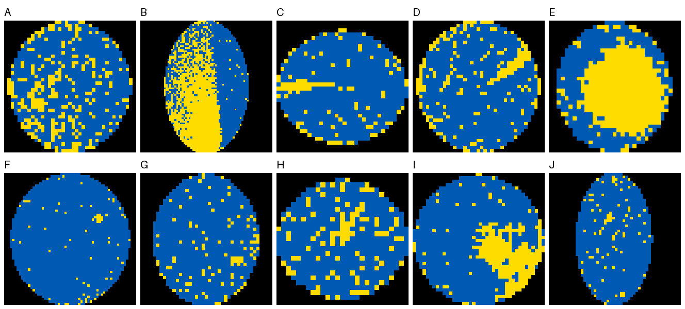

# What separates shared Qwen misses from shared hits on loc wafers?

On this validation set, the three `loc` maps recognized by all six Qwen checkpoints have less yellow area than any of the seven missed by all six. The ten maps recognized by only some checkpoints overlap both groups. Shape also matters to the error description: two rim-connected streaks draw only `scratch` and `edge-loc` predictions, while a central branching cluster draws six `center` predictions.

## Same ten maps, six frozen predictions per map

The plate uses the original 256 × 256 RGB inputs. A–J are ordered by a salted hash of the sample ID. A single reviewer (Codex) wrote the [lettered observations](showcase/qwen-loc-review/observations.md) before opening the per-letter key. The reviewer knew the true class and the group sizes. This was a descriptive review of selected extremes. Each checkpoint contributed the first greedy validation pass, for three training seeds (17, 42, 123) at two steps (200, 250).



| Case | Visible feature | Predictions across the six checkpoints |
| --- | --- | --- |
| A | Scattered cells with a denser lower-left patch | 4 edge-loc, 2 random |
| B | Broad, dense region covering much of the left half | 4 random, 2 donut |
| C | Thin horizontal streak from the left rim | 4 scratch, 2 edge-loc |
| D | Oblique streak reaching the upper-right rim | 5 edge-loc, 1 scratch |
| E | Large, roughly round central patch extending right | 5 near-full, 1 center |
| F | Sparse specks and one small interior island | 6 loc |
| G | Scattered cells, strongest concentration near the right rim | 6 loc |
| H | Central branching cluster with additional scattered blocks | 6 center |
| I | Broad, irregular lower-right patch touching the rim | 3 random, 2 edge-loc, 1 donut |
| J | Sparse interior cells on a narrow wafer | 6 loc |

Case G and case I both have a concentration at the rim, yet the checkpoints recognize only G as `loc`. Cases B and I both have broad asymmetric regions and attract several different labels. The [prediction key](showcase/qwen-loc-review/predictions.csv) identifies the exact map and checkpoint for every entry. The recorded source annotations supply the reference class. The review provides no independent adjudication of those labels.

## Yellow area across all 20 validation loc maps

After reviewing the ten images, we measured the fraction of yellow pixels among yellow and blue pixels for every validation map labeled `loc`. Black background and padding are excluded. The fraction measures area on the model input after image resizing. The underlying units in this table are maps. Predictions from checkpoints sharing the same map and training trajectory are correlated.

| Checkpoints correct | Maps | Median yellow area | Observed range |
| --- | ---: | ---: | ---: |
| 0 of 6 | 7 | 23.42% | 14.18–55.69% |
| 1–5 of 6 | 10 | 14.96% | 4.80–18.91% |
| 6 of 6 | 3 | 7.47% | 3.10–9.78% |

The [per-map area counts](showcase/qwen-loc-review/coverage.csv) include the mixed cases. This association was identified on development data after inspecting errors. With three unanimous hits and overlap in the mixed group, these numbers support neither a production cutoff nor a causal claim about the model.

## Follow-up on all validation classes

The [training-area quartile analysis](qwen-validation-area.md) measures both directions of `loc` confusion across all 160 validation maps. It includes training support, per-checkpoint counts and a candidate sampling experiment.

## Reproduce

Run from the repository root with the locked project environment. If the local images are missing, follow the [public data preparation procedure](../README.md) to produce `data/wm811k-lot17`. Each input PNG is checked against its frozen manifest SHA-256. The plate and answer key are generated separately so a second reviewer can record their own observations before opening the predictions.

```sh
uv run --frozen python analysis/qwen_loc_review.py plate data/wm811k-lot17 plate.png
uv run --frozen python analysis/qwen_loc_review.py reveal predictions.csv
uv run --frozen python analysis/qwen_loc_review.py coverage data/wm811k-lot17 coverage.csv
```
