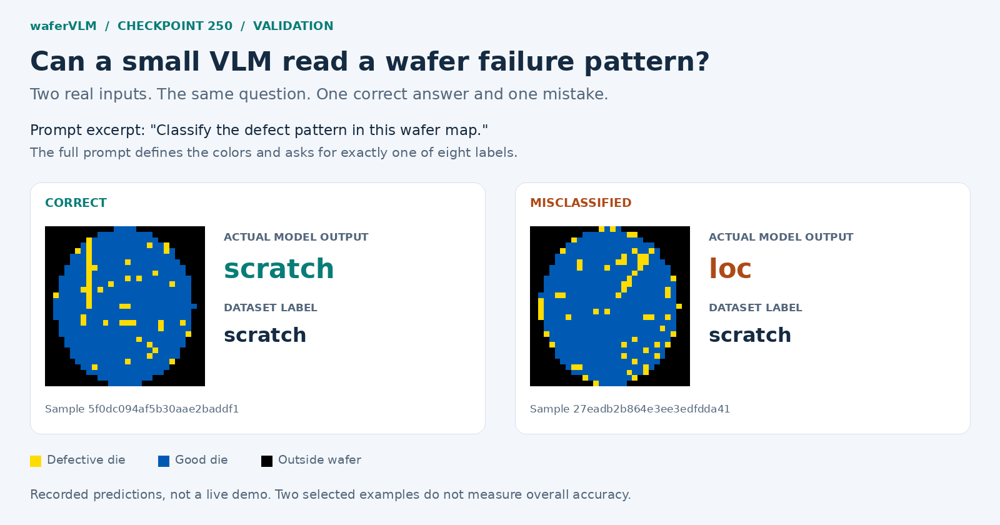
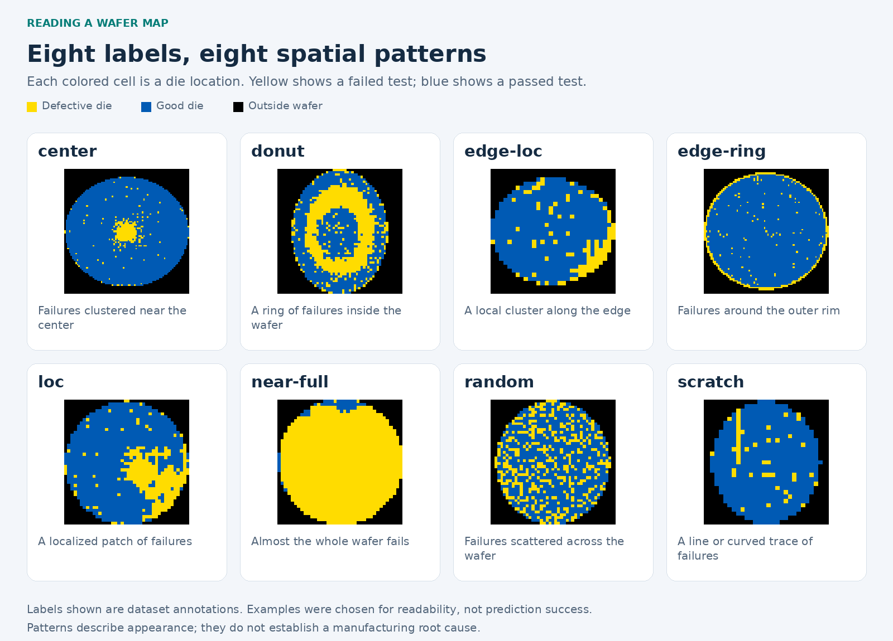
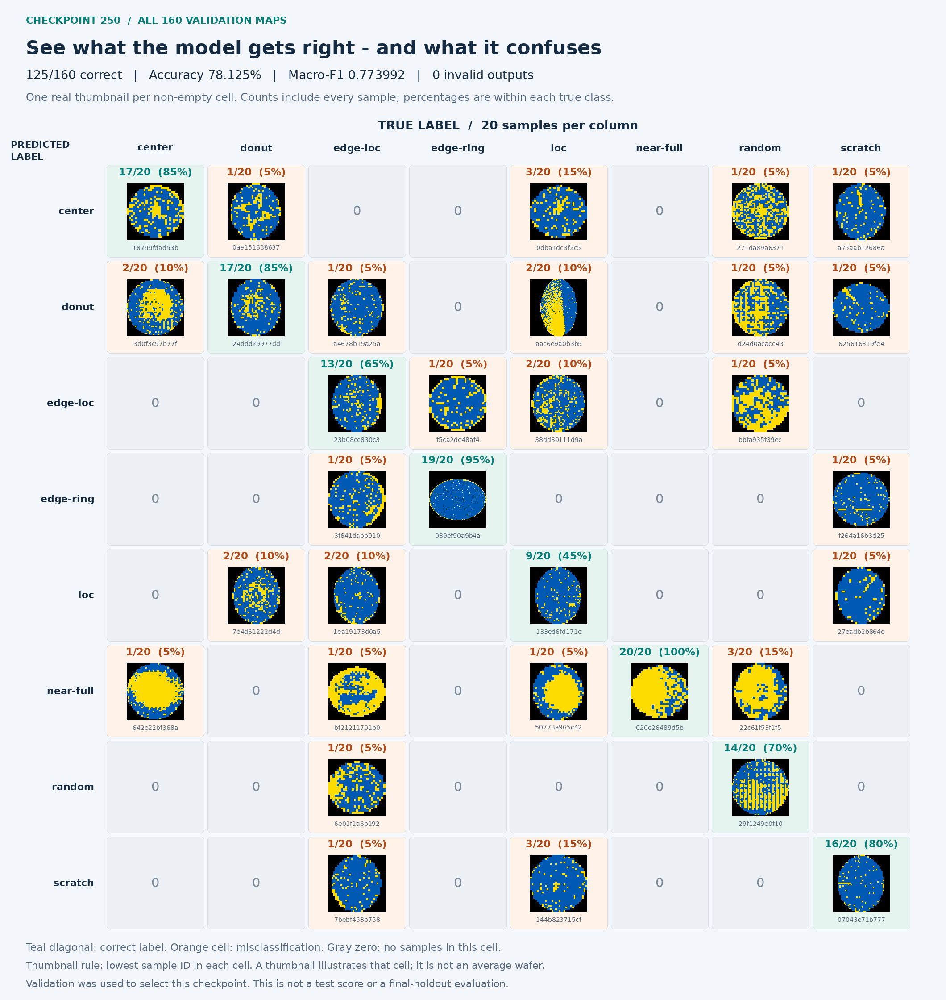

# Checkpoint-250 visual showcase

Real WM-811K inputs and **recorded validation predictions**, from [run 42682266526](https://github.com/jasonjiang8866/waferVLM/actions/runs/42682266526). The model and original evidence are in the [release](https://github.com/jasonjiang8866/waferVLM/releases/tag/continuation-300-v1).

This showcase reuses all 160 predictions: **125 correct, 35 incorrect, 0 invalid**. Accuracy is **78.125%** and macro-F1 is **0.773992**. Validation selected this checkpoint; these are not test or final-holdout results. No new inference ran.

## From a wafer map to a label

A wafer contains many dies (individual chips). A wafer map records their test results at each location. Yellow cells are defective dies, blue cells are good dies, and black is outside the wafer. The model identifies the spatial pattern of failures. It does not infer a process root cause.



The image quotes the first sentence of the actual prompt. The full prompt is:

> Classify the defect pattern in this wafer map. Yellow cells are defective, blue cells are good dies, and black is outside the wafer. Return exactly one label from: center, donut, edge-loc, edge-ring, loc, near-full, random, scratch. Do not explain.

Greedy decoding, thinking disabled, at most 16 new tokens. The response fields shown are the original recorded model outputs.

## Eight-label guide



These eight examples were selected editorially for visible morphology, not by model confidence or prediction success. Real annotations can be visually ambiguous; they are retained unchanged. For transparency, the selected `loc` example is predicted `donut`, not `loc`. Normal (`none`) and unknown defects are outside the current eight-class experiment.

| Dataset label | Appearance | Selected sample ID | Checkpoint-250 prediction |
|---|---|---|---|
| `center` | Failures clustered near the center | `4c0cb116592b2babf3807229` | `center` |
| `donut` | A ring of failures inside the wafer | `32f11e5f884139a8eb1a749a` | `donut` |
| `edge-loc` | A local cluster along the edge | `5e90d1e702ea245b652ba450` | `edge-loc` |
| `edge-ring` | Failures around the outer rim | `0ad3c35371e7fe06efb357a2` | `edge-ring` |
| `loc` | A localized patch of failures | `dd855c3b619057c30af18ade` | `donut` |
| `near-full` | Almost the whole wafer fails | `8e56c17bd8a8ad08868d3973` | `near-full` |
| `random` | Failures scattered across the wafer | `8507bcec612300fe21c3be98` | `random` |
| `scratch` | A line or curved trace of failures | `5f0dc094af5b30aae2baddf1` | `scratch` |

## Image confusion matrix

**X / columns = true labels; Y / rows = predicted labels.** This orientation is intentional. Every true-label column contains 20 samples, so its percentages sum to 100%. The diagonal counts are per-class correct predictions (recall times 20), not precision.

[](image-confusion-matrix.png)

Open the image at full size to inspect the thumbnails. Each non-empty cell shows the lowest sample ID in that cell; all other sample IDs are listed in [evidence.json](evidence.json). Zero-count cells contain no invented example. Original image colors and aspect ratios are preserved with nearest-neighbor scaling. Headers, captions and borders were added only after inference.

### Accessible count table

| Predicted \ True | center | donut | edge-loc | edge-ring | loc | near-full | random | scratch |
|---|---:|---:|---:|---:|---:|---:|---:|---:|
| center | 17 | 1 | 0 | 0 | 3 | 0 | 1 | 1 |
| donut | 2 | 17 | 1 | 0 | 2 | 0 | 1 | 1 |
| edge-loc | 0 | 0 | 13 | 1 | 2 | 0 | 1 | 0 |
| edge-ring | 0 | 0 | 1 | 19 | 0 | 0 | 0 | 1 |
| loc | 0 | 2 | 2 | 0 | 9 | 0 | 0 | 1 |
| near-full | 1 | 0 | 1 | 0 | 1 | 20 | 3 | 0 |
| random | 0 | 0 | 1 | 0 | 0 | 0 | 14 | 0 |
| scratch | 0 | 0 | 1 | 0 | 3 | 0 | 0 | 16 |

## Provenance and reproduction

The public source is the [qingyi WM-811K mirror](https://www.kaggle.com/datasets/qingyi/wm811k-wafer-map). The pinned dataset recipe, source hashes and data terms are documented in [the data audit](../../data-audit.md). These visual excerpts do not relicense the upstream dataset under the code's MIT license.

The CPU-only builder verifies the original release ZIP, evaluation checksums, full validation coverage, raw-output parsing, every image hash, and recomputed metrics before drawing. [predictions.jsonl](predictions.jsonl) is an unchanged copy of the released prediction file. [evidence.json](evidence.json) records source identities, sample selections, matrix orientation and output hashes.

From the repository root, with the release ZIP downloaded and a new output directory:

```bash
uv sync --frozen
# The source recipe verifies the pinned public archive before loading its pickle.
uv run --frozen python scripts/prepare_public_data.py \
  --trust-pickle --output data/wm811k-lot17
# Requires DejaVuSans.ttf and DejaVuSans-Bold.ttf (fonts-dejavu-core on Debian/Ubuntu).
uv run --frozen python scripts/build_showcase.py \
  --dataset data/wm811k-lot17 \
  --release-zip /path/to/wafervlm-run-42682266526.zip \
  --output outputs/checkpoint-250-showcase
```

Use `--font-dir` if DejaVu fonts are installed elsewhere. The builder does not load model weights, train, call RunPod, or evaluate test/final-holdout data. It deliberately accepts only this pinned release; a new checkpoint requires an explicit evidence and example-selection update.
