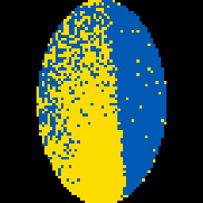
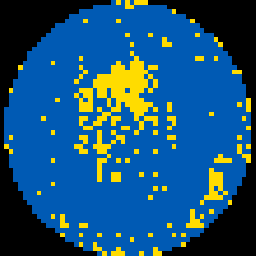
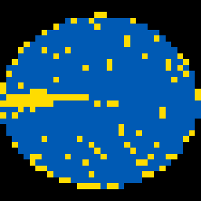
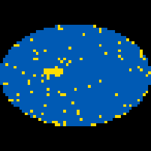

# Which wafer maps should an engineer review first?

The tables count classification errors that enter a fixed-size review queue. A human review outcome has yet to be measured. The maximum class probability is used only for ranking within a batch.

The [protocol](protocol.md) fixes a 10% primary budget and 5% and 20% sensitivity checks. The development pilot informed this analysis. The holdout results below are retrospective on previously published predictions. Both splits use each model’s first process.

Uniform random review would capture 10% of development errors and 14/148 (9.46%) of holdout errors in expectation. Residual error rate divides errors left by unreviewed maps. A loc miss has true label loc. A false loc call has predicted label loc and another true label.

[All 36 budget comparisons](summary.csv) · [Per-map rankings for both splits](ranks)

## Validation at the 10% budget

| Model | Reviewed | Errors sent / all | Capture | Errors left / unreviewed | Residual error rate | loc misses sent / all | False loc calls sent / all |
|---|---:|---:|---:|---:|---:|---:|---:|
| seed17-linear | 16/160 | 6/26 | 23.1% | 20/144 | 13.9% | 0/6 | 5/11 |
| seed17-lora | 16/160 | 7/20 | 35.0% | 13/144 | 9.0% | 3/7 | 2/4 |
| seed42-linear | 16/160 | 5/29 | 17.2% | 24/144 | 16.7% | 3/13 | 1/4 |
| seed42-lora | 16/160 | 7/21 | 33.3% | 14/144 | 9.7% | 3/7 | 2/2 |
| seed123-linear | 16/160 | 9/30 | 30.0% | 21/144 | 14.6% | 1/11 | 2/3 |
| seed123-lora | 16/160 | 8/22 | 36.4% | 14/144 | 9.7% | 2/6 | 2/4 |

## Holdout at the 10% budget

| Model | Reviewed | Errors sent / all | Capture | Errors left / unreviewed | Residual error rate | loc misses sent / all | False loc calls sent / all |
|---|---:|---:|---:|---:|---:|---:|---:|
| seed17-linear | 14/148 | 8/36 | 22.2% | 28/134 | 20.9% | 1/8 | 3/12 |
| seed17-lora | 14/148 | 12/34 | 35.3% | 22/134 | 16.4% | 2/10 | 5/11 |
| seed42-linear | 14/148 | 5/42 | 11.9% | 37/134 | 27.6% | 0/16 | 3/7 |
| seed42-lora | 14/148 | 7/30 | 23.3% | 23/134 | 17.2% | 0/9 | 3/7 |
| seed123-linear | 14/148 | 10/40 | 25.0% | 30/134 | 22.4% | 3/14 | 3/8 |
| seed123-lora | 14/148 | 10/35 | 28.6% | 25/134 | 18.7% | 2/11 | 0/5 |

## Which loc errors reach the reviewer?

Seed-17 LoRA on development. The queue ends at rank 16. Each thumbnail links to its original PNG.

| Map | Sample ID | Rank | Review | True → predicted | Max probability |
|---|---|---:|---|---|---:|
|  | aac6e9a0b3b5aa660ce62121 | 2 | sent | loc → edge-loc | 41.15% |
|  | 4000f35bad1dc0340fe42ced | 7 | sent | loc → donut | 50.08% |
|  | be8bdd8417b86a07da6a61f2 | 91 | outside | loc → scratch | 94.26% |
|  | 919d270be3fcd213ba2ae0e2 | 38 | outside | loc → center | 75.74% |
|  | 144b823715cf1e23c92ad201 | 33 | outside | loc → center | 70.83% |
|  | 50773a965c423a8290e617f2 | 30 | outside | loc → near-full | 69.46% |

Reproduce from the repository root with `uv run --frozen python -m analysis.dino_review_queue`. Pass `--images` to check the gallery against the images directory produced by `scripts/prepare_public_data.py`.
