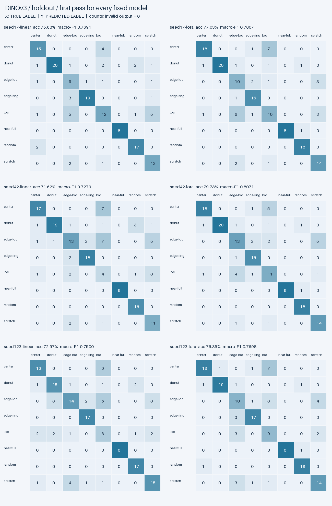

# DINOv3 holdout confirmation

Run [44843362544](https://github.com/jasonjiang8866/waferVLM/actions/runs/44843362544); controller `303dcc779e5b3f7947148251d5b0815d006624e7`; inference GPU: NVIDIA GeForce RTX 4090.

Accepted **0/18 validation passes** in this artifact; **888/888 holdout predictions** in this artifact. Counts for the other phase are reported separately.

The first independent process is primary for every fixed model. Seeds are training seeds; repeated processes are reproducibility checks. Seed 17 is exploratory, seeds 42/123 confirm the frozen protocol.

| Model | Selected epoch | Accuracy | Macro-F1 | loc recall | Inference s | Peak allocated MiB |
| --- | --- | --- | --- | --- | --- | --- |
| seed17-linear | 10 | 75.6757% | 0.769054 | 60.00% | 2.120 | 122.30 |
| seed17-lora | 5 | 77.0270% | 0.780653 | 50.00% | 2.097 | 123.56 |
| seed42-linear | 9 | 71.6216% | 0.727930 | 20.00% | 2.086 | 122.30 |
| seed42-lora | 5 | 79.7297% | 0.807057 | 55.00% | 2.940 | 123.56 |
| seed123-linear | 10 | 72.9730% | 0.750038 | 30.00% | 2.156 | 122.30 |
| seed123-lora | 3 | 76.3514% | 0.769831 | 45.00% | 2.300 | 123.56 |

## Within-seed LoRA minus linear

| Seed | Accuracy difference (pp) | Macro-F1 difference |
| --- | --- | --- |
| 17 | +1.3514 | +0.011599 |
| 42 | +8.1081 | +0.079127 |
| 123 | +3.3784 | +0.019793 |

## Paired with published Qwen seed 17, step 250

| DINO model | Both correct | Only DINO correct | Only Qwen correct | Both wrong | Total |
| --- | --- | --- | --- | --- | --- |
| seed17-linear | 91 | 21 | 13 | 23 | 148 |
| seed17-lora | 91 | 23 | 13 | 21 | 148 |
| seed42-linear | 85 | 21 | 19 | 23 | 148 |
| seed42-lora | 93 | 25 | 11 | 19 | 148 |
| seed123-linear | 86 | 22 | 18 | 22 | 148 |
| seed123-lora | 91 | 22 | 13 | 22 | 148 |

## Per-class recall

| Model | center | donut | edge-loc | edge-ring | loc | near-full | random | scratch |
| --- | --- | --- | --- | --- | --- | --- | --- | --- |
| seed17-linear | 75.00% | 100.00% | 45.00% | 95.00% | 60.00% | 100.00% | 85.00% | 60.00% |
| seed17-lora | 90.00% | 100.00% | 50.00% | 80.00% | 50.00% | 100.00% | 90.00% | 70.00% |
| seed42-linear | 85.00% | 95.00% | 65.00% | 90.00% | 20.00% | 100.00% | 80.00% | 55.00% |
| seed42-lora | 90.00% | 100.00% | 65.00% | 80.00% | 55.00% | 100.00% | 90.00% | 70.00% |
| seed123-linear | 80.00% | 75.00% | 70.00% | 85.00% | 30.00% | 100.00% | 85.00% | 75.00% |
| seed123-lora | 90.00% | 95.00% | 50.00% | 85.00% | 45.00% | 100.00% | 90.00% | 70.00% |

All per-image predictions retain eight class probabilities in the canonical label order. The CSV joins IDs, image SHA-256 and ground truth. Full counts, metrics, repeat changes and timings are in [analysis.json](analysis.json).

## Lot-group paired bootstrap

10,000 paired resamples; RNG seed 20261110; 143 lot groups; fixed eight classes; undefined F1 = 0. Percentile 95% intervals below are within-seed LoRA minus linear.

| Seed | Accuracy 95% interval (pp) | Macro-F1 95% interval |
| --- | --- | --- |
| 17 | -4.0268 to +6.7568 | -0.040789 to +0.065070 |
| 42 | +2.0134 to +14.3836 | +0.020785 to +0.137091 |
| 123 | -2.7027 to +9.5238 | -0.037934 to +0.077529 |

This is an additional prespecified comparison on the same holdout whose Qwen results were already public. Six weight hashes and the inference/statistical protocol were committed before DINO holdout inference. No endpoint or seed was selected using this set.

## Seed-17 LoRA versus published Qwen

| Model | Accuracy | Macro-F1 |
| --- | --- | --- |
| Qwen seed17 step250 | 70.2703% | 0.711854 |
| DINO seed17 LoRA | 77.0270% | 0.780653 |

| Metric | DINO minus Qwen | Paired lot-group 95% interval |
| --- | --- | --- |
| accuracy | +0.067568 | -0.013245 to +0.146873 |
| macro_f1 | +0.068800 | -0.008452 to +0.151392 |

Training hardware: seed 17: NVIDIA GeForce RTX 5090; seed 42: NVIDIA GeForce RTX 4090; seed 123: NVIDIA GeForce RTX 4090. Each within-seed pair shares a training GPU type. Between-seed variation also includes the seed-17 versus confirmation-hardware difference.

DINO timers include image verification, decoding, preprocessing, transfer and forward execution, exclude model loading, and use no warmup. Qwen previously timed generation only; these are not directly comparable speed measurements. DINO uses an eight-way argmax classifier and 10 epochs / 990 updates / 7,900 training presentations. Qwen uses greedy text generation (up to 16 new tokens), microbatch 1 / accumulation 8 and 250 optimizer steps under its own continuation protocol. The comparison is not matched for model size, pretraining, adaptation location or training compute.
