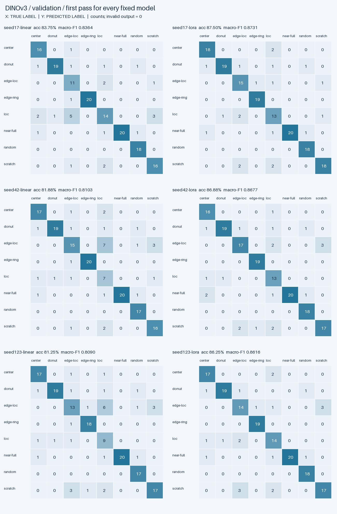

# DINOv3 validation confirmation

Run [44537796019](https://github.com/jasonjiang8866/waferVLM/actions/runs/44537796019); controller `cf55c9277c3c5da3278d5a46733ae648d03bbdac`; inference GPU: NVIDIA GeForce RTX 4090.

Accepted **18/18 validation passes** in this artifact; **0/888 holdout predictions** in this artifact. Counts for the other phase are reported separately.

The first independent process is primary for every fixed model. Seeds are training seeds; repeated processes are reproducibility checks. Seed 17 is exploratory, seeds 42/123 confirm the frozen protocol.

| Model | Selected epoch | Accuracy | Macro-F1 | loc recall | Inference s | Peak allocated MiB |
| --- | --- | --- | --- | --- | --- | --- |
| seed17-linear | 10 | 83.7500% | 0.836449 | 70.00% | 1.221 | 122.30 |
| seed17-lora | 5 | 87.5000% | 0.873125 | 65.00% | 1.289 | 123.56 |
| seed42-linear | 9 | 81.8750% | 0.810348 | 35.00% | 1.208 | 122.30 |
| seed42-lora | 5 | 86.8750% | 0.867664 | 65.00% | 1.374 | 123.56 |
| seed123-linear | 10 | 81.2500% | 0.808981 | 45.00% | 1.258 | 122.30 |
| seed123-lora | 3 | 86.2500% | 0.861604 | 70.00% | 1.402 | 123.56 |

## Within-seed LoRA minus linear

| Seed | Accuracy difference (pp) | Macro-F1 difference |
| --- | --- | --- |
| 17 | +3.7500 | +0.036676 |
| 42 | +5.0000 | +0.057316 |
| 123 | +5.0000 | +0.052623 |

## Paired with published Qwen seed 17, step 250

| DINO model | Both correct | Only DINO correct | Only Qwen correct | Both wrong | Total |
| --- | --- | --- | --- | --- | --- |
| seed17-linear | 112 | 22 | 13 | 13 | 160 |
| seed17-lora | 118 | 22 | 7 | 13 | 160 |
| seed42-linear | 110 | 21 | 15 | 14 | 160 |
| seed42-lora | 116 | 23 | 9 | 12 | 160 |
| seed123-linear | 109 | 21 | 16 | 14 | 160 |
| seed123-lora | 115 | 23 | 10 | 12 | 160 |

## Per-class recall

| Model | center | donut | edge-loc | edge-ring | loc | near-full | random | scratch |
| --- | --- | --- | --- | --- | --- | --- | --- | --- |
| seed17-linear | 80.00% | 95.00% | 55.00% | 100.00% | 70.00% | 100.00% | 90.00% | 80.00% |
| seed17-lora | 90.00% | 95.00% | 75.00% | 95.00% | 65.00% | 100.00% | 90.00% | 90.00% |
| seed42-linear | 85.00% | 95.00% | 75.00% | 100.00% | 35.00% | 100.00% | 85.00% | 80.00% |
| seed42-lora | 80.00% | 95.00% | 85.00% | 95.00% | 65.00% | 100.00% | 90.00% | 85.00% |
| seed123-linear | 85.00% | 95.00% | 65.00% | 90.00% | 45.00% | 100.00% | 85.00% | 85.00% |
| seed123-lora | 85.00% | 95.00% | 70.00% | 95.00% | 70.00% | 100.00% | 90.00% | 85.00% |

All per-image predictions retain eight class probabilities in the canonical label order. The CSV joins IDs, image SHA-256 and ground truth. Full counts, metrics, repeat changes and timings are in [analysis.json](analysis.json).

Six Qwen diagnostic first passes are pinned to PR #54 source `ae2cd56f7047c3015a34711324072f90f70dac2e` and verified against the committed receipt hashes.

## Fresh-process reproducibility

| Model | Pass 2 label changes | Pass 3 label changes |
| --- | --- | --- |
| seed17-linear | 0 | 0 |
| seed17-lora | 0 | 0 |
| seed42-linear | 0 | 0 |
| seed42-lora | 0 | 0 |
| seed123-linear | 0 | 0 |
| seed123-lora | 0 | 0 |

Changed IDs for each pass are retained in analysis.json. Historical seed-17 selected-epoch predictions remain the primary evidence for the separate original development report; its batch-1 reload is not one of these 18 passes.

## Qwen common-error diagnostics

| Model | Rescued /16 | loc rescued /7 | Other rescued classes |
| --- | --- | --- | --- |
| seed17-linear | 7 | 3 | scratch: 1, edge-loc: 1, donut: 1, edge-ring: 1 |
| seed17-lora | 6 | 3 | scratch: 1, edge-loc: 1, donut: 1 |
| seed42-linear | 6 | 2 | scratch: 1, edge-loc: 1, donut: 1, edge-ring: 1 |
| seed42-lora | 6 | 3 | scratch: 1, edge-loc: 1, donut: 1 |
| seed123-linear | 5 | 2 | scratch: 1, edge-loc: 1, donut: 1 |
| seed123-lora | 6 | 3 | scratch: 1, edge-loc: 1, donut: 1 |

This subset is selected by Qwen performance. Use the complete 160 maps for overall performance claims. Every rescued ID and remaining prediction is in analysis.json; all six Qwen and all six DINO labels are in [common-errors-16.csv](common-errors-16.csv).

| Common-miss loc ID | seed17-linear | seed17-lora | seed42-linear | seed42-lora | seed123-linear | seed123-lora |
| --- | --- | --- | --- | --- | --- | --- |
| 0dba1dc3f2c5cf63eda306ba | loc | loc | center | loc | loc | loc |
| 38dd30111d9a15f20ad272cc | loc | loc | loc | loc | loc | loc |
| 50773a965c423a8290e617f2 | near-full | near-full | near-full | near-full | near-full | near-full |
| aac6e9a0b3b5aa660ce62121 | edge-loc | edge-loc | edge-loc | edge-loc | edge-loc | edge-loc |
| be8bdd8417b86a07da6a61f2 | scratch | scratch | scratch | scratch | scratch | scratch |
| c882bea412b6513af0935266 | edge-loc | scratch | edge-loc | scratch | edge-loc | scratch |
| dd855c3b619057c30af18ade | loc | loc | loc | loc | edge-loc | loc |

| Seed-17 arm | Historical selected vs new pass-1 label changes |
| --- | --- |
| linear | 0 |
| lora | 2 |

| Historical arm | Changed ID | True | Historical selected | New pass 1 |
| --- | --- | --- | --- | --- |
| lora | e400f55a09848e7ba9bed36c | scratch | edge-loc | scratch |
| lora | f5ca2de48af4e569a3ce1c2b | edge-ring | scratch | edge-loc |

Historical seed-17 selected predictions were produced on RTX 5090; this validation run uses RTX 4090. The observed differences do not isolate a single cause and do not select a new weight or a favorable repeat.

Training hardware: seed 17: NVIDIA GeForce RTX 5090; seed 42: NVIDIA GeForce RTX 4090; seed 123: NVIDIA GeForce RTX 4090. Each within-seed pair shares a training GPU type. Between-seed variation also includes the seed-17 versus confirmation-hardware difference.

DINO timers include image verification, decoding, preprocessing, transfer and forward execution, exclude model loading, and use no warmup. Qwen previously timed generation only; these are not directly comparable speed measurements. DINO uses an eight-way argmax classifier and 10 epochs / 990 updates / 7,900 training presentations. Qwen uses greedy text generation (up to 16 new tokens), microbatch 1 / accumulation 8 and 250 optimizer steps under its own continuation protocol. The comparison is not matched for model size, pretraining, adaptation location or training compute.
