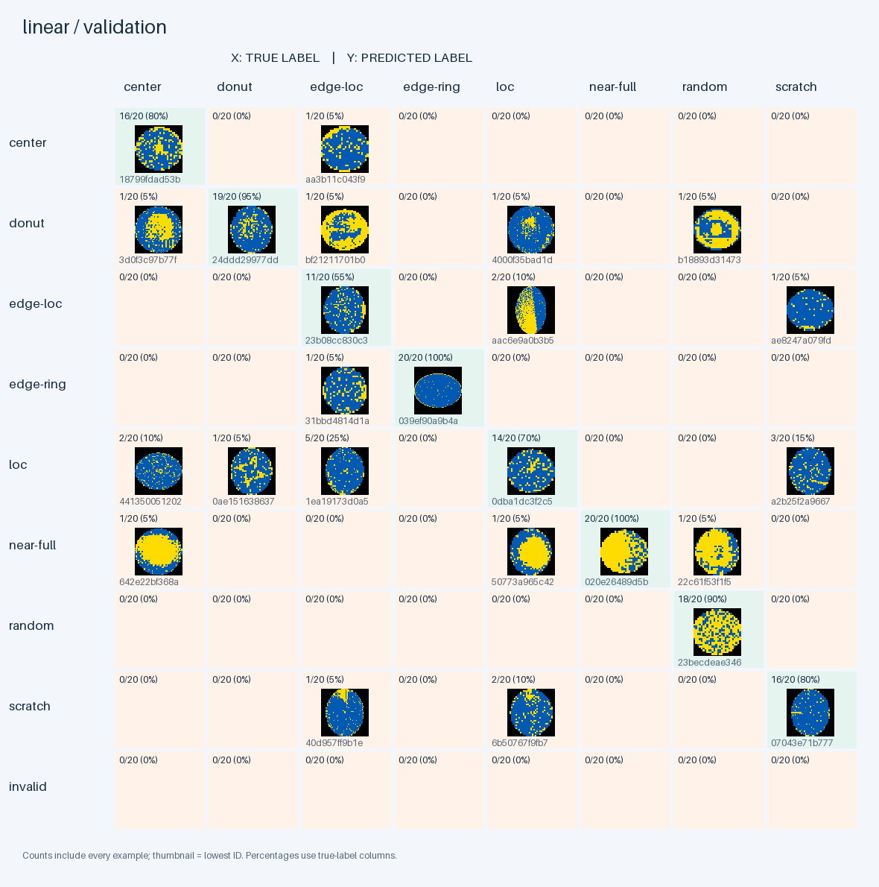
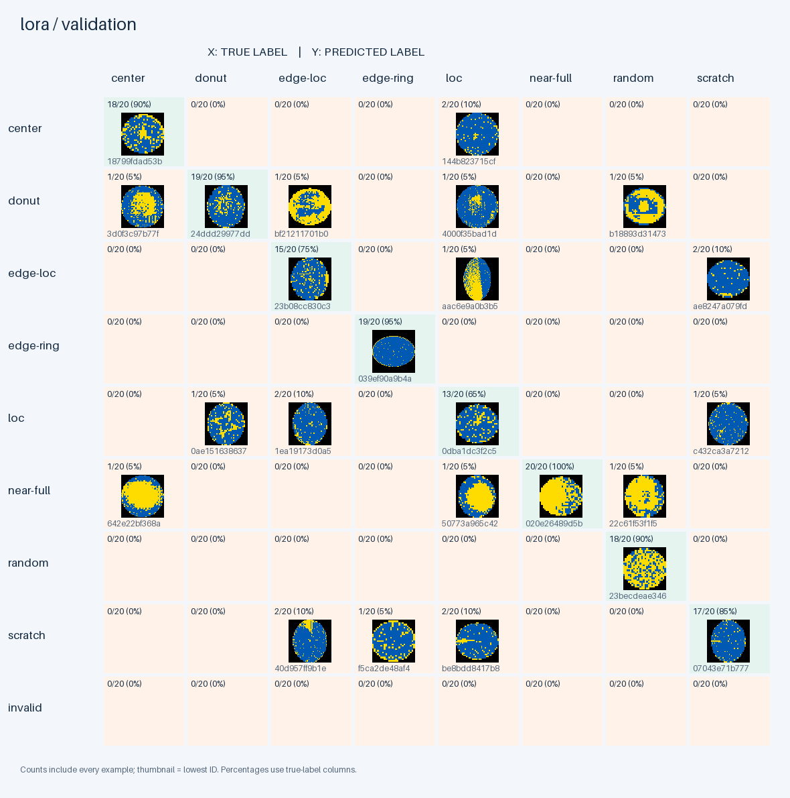
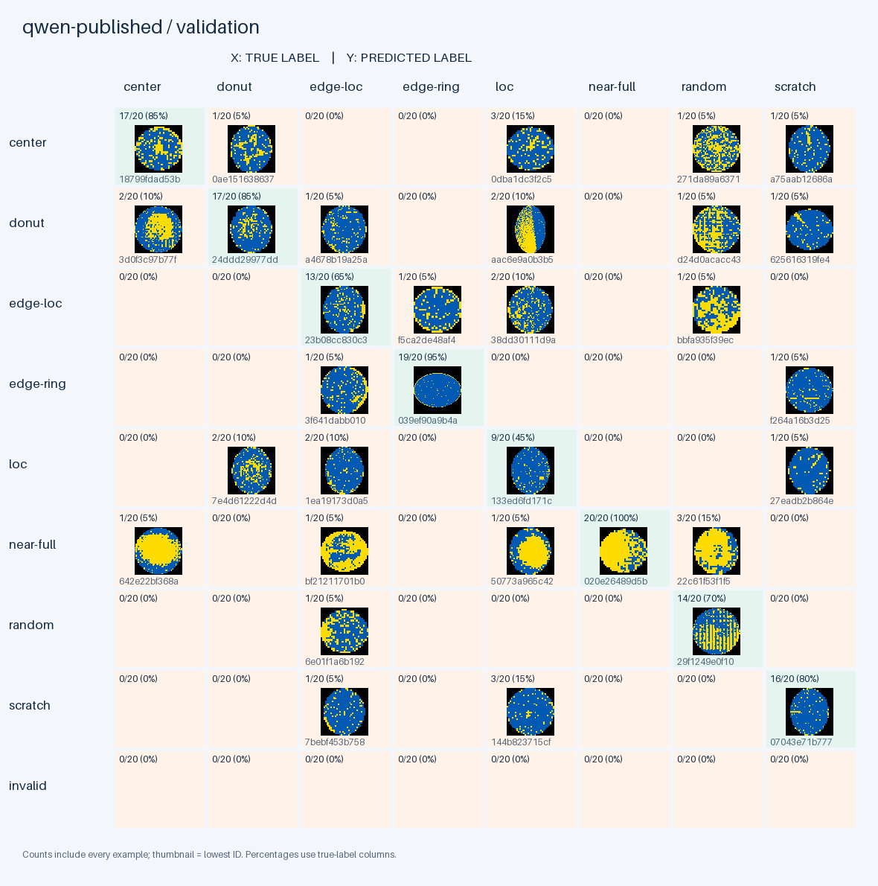
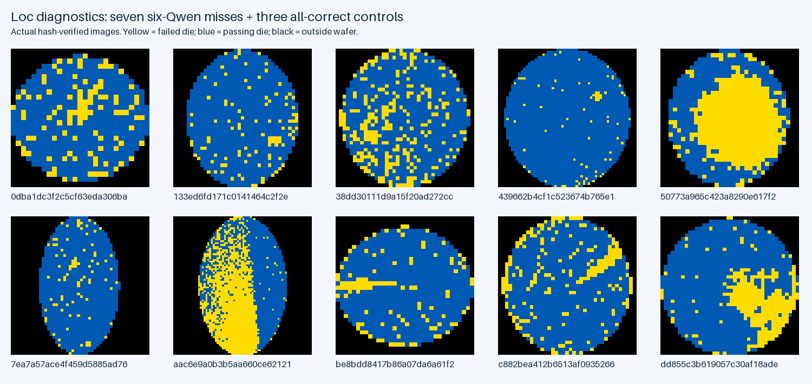
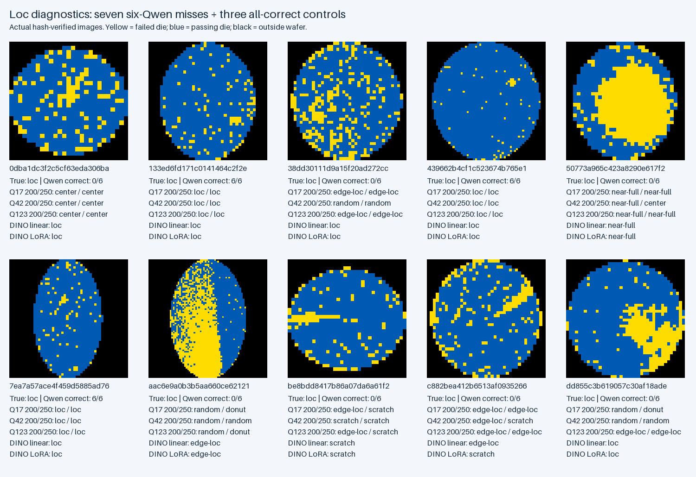

# Can DINOv3 recognize Qwen’s shared wafer-map errors?

On the complete 160-map development validation set, the published seed-17 DINOv3 linear probe correctly classified 134 maps and vision LoRA 139, versus 125 for the published Qwen seed-17 step-250 checkpoint. Among the 16 maps missed by all six Qwen confirmation checkpoints, **linear rescues 7 and LoRA 6**. Both rescue the same **3 of 7 loc maps**. LoRA’s overall gain does not imply dominance on this Qwen-selected subset.

These are CPU analyses of existing predictions, not new inference. At this CPU report's initial publication, training seeds 42/123 and the new validation/holdout runs had not run. The subsequent [cross-seed report](../../dinov3-confirmation-results.md) now verifies 18/18 validation passes; holdout inference is in progress. This report retains the historical selected outputs and makes no holdout claim.

## Fixed evidence and alignment

- Main at analysis start: `5b254e191ece3d5e28c27800d9e21bfb820acf56` (merged [Qwen holdout PR #53](https://github.com/jasonjiang8866/waferVLM/pull/53)).
- [PR #54](https://github.com/jasonjiang8866/waferVLM/pull/54) was open. Its six Qwen first-pass files were read at fixed commit `ae2cd56f7047c3015a34711324072f90f70dac2e` and retained byte-for-byte in `docs/evidence/qwen-validation-first-pass/`. Every digest matches the archived repeat receipt.
- The overall comparator is the **published** Qwen seed-17 step-250 file, not a substituted fresh repeat. The six fresh Qwen first passes define the diagnostic membership only.
- DINO primary predictions are the original selected batch-size-8 outputs from [run 43716864164](https://github.com/jasonjiang8866/waferVLM/actions/runs/43716864164). Batch-size-1 reload predictions remain separate.
- All files join by unique sample ID; exact ID set, true label, image SHA-256, response parsing, 160-row completeness, and all eight DINO probabilities/argmax were checked. The original PNG bytes for all 160 maps were independently regenerated from the pinned public dataset and hash-verified.
- The downloaded DINO artifact ZIP and nested archive match their recorded hashes; the existing portable verifier rechecked all six 10-epoch training histories, selected weights, base model, image/source provenance and reload identities.
- Selected weight SHA-256: linear `ffd76f22ac6838095cd6673a1c018369976d4c58d54ad66a1058e3928a8359f2`; LoRA `4cc6b86b051a079602d3791311aeb5b3b2ca51109f4404a7cc7afa9744059c6d`.

[Complete analysis and input digests](analysis.json) · [All 160 paired rows](all-160.csv) · [All 16 shared errors](common-errors-16.csv) · [Ten loc cases](loc-10.csv)

## Complete validation comparison

| Model | Correct / 160 | Accuracy | Macro-F1 |
|---|---:|---:|---:|
| linear | 134 | 83.750% | 0.836449 |
| lora | 139 | 86.875% | 0.867173 |
| qwen-published | 125 | 78.125% | 0.773992 |

| DINO arm vs published Qwen | Both correct | DINO only correct | Qwen only correct | Both wrong | Total |
|---|---:|---:|---:|---:|---:|
| linear | 112 | 22 | 13 | 13 | 160 |
| lora | 117 | 22 | 8 | 13 | 160 |

LoRA − linear: +3.125 accuracy percentage points / +0.030724 macro-F1. This is one development seed. DINO uses 7,900 training presentations / 990 optimizer updates per trial and an eight-way argmax head. Qwen uses language generation and a different step-250 training budget. The cross-model comparison combines architecture, pretraining, adaptation and output differences; it is not compute-matched.

| True label (20 maps each) | Qwen recall | Linear recall | LoRA recall |
|---|---:|---:|---:|
| center | 85% | 80% | 90% |
| donut | 85% | 95% | 95% |
| edge-loc | 65% | 55% | 75% |
| edge-ring | 95% | 100% | 95% |
| loc | 45% | 70% | 65% |
| near-full | 100% | 100% | 100% |
| random | 70% | 90% | 90% |
| scratch | 80% | 80% | 85% |

### Confusion matrices

X = true label; Y = predicted label. Counts include every map; thumbnails use the lowest ID in each nonempty cell. Numeric counts and class metrics are in `analysis.json`.







## Loc: visible morphology first

The ten maps below were selected using Qwen only: every one of the seven all-wrong loc cases and all three all-correct controls. The image-only contact sheet was visually inspected before writing the case interpretation. This is descriptive review, not a blinded labeling study or grounds to change the dataset labels. Yellow denotes failed dies, blue passing dies, black outside the wafer.



| Sample ID | Visible spatial pattern |
|---|---|
| `0dba1dc3f2c5cf63eda306ba` | Coarse circular map; an irregular central cluster plus scattered failures around the wafer. |
| `133ed6fd171c0141464c2f2e` | Scattered small failures with extra concentration near the right edge and lower rim. |
| `38dd30111d9a15f20ad272cc` | Many scattered failures; a denser vertical/irregular concentration occupies the lower-left area. |
| `439662b4cf1c523674b765e1` | Mostly passing; a small compact cluster in the upper-right interior and sparse failures near the lower-right boundary. |
| `50773a965c423a8290e617f2` | A large solid failure patch covers most of the center-right interior; a passing crescent remains on the left. |
| `7ea7a57ace4f459d5885ad76` | Narrow oval map; a small short diagonal cluster in the upper-middle interior with scattered isolated failures. |
| `aac6e9a0b3b5aa660ce62121` | Narrow oval map; dense failure coverage on the left/lower side, becoming more scattered toward the upper-left. |
| `be8bdd8417b86a07da6a61f2` | A narrow horizontal failure band extends inward from the left edge; other scattered failures and an irregular lower-rim cluster. |
| `c882bea412b6513af0935266` | A diagonal elongated cluster extends toward the upper-right edge, alongside scattered failures around the perimeter. |
| `dd855c3b619057c30af18ade` | A large irregular lower-right patch touching the boundary, with smaller nearby clusters and sparse interior failures. |

### Predictions on the same ten maps

All true labels are `loc`. Q columns name training seed / checkpoint step. Q17/250 here is the first repeat used by PR #54; the full-set comparator above remains the original published prediction file.

| ID | True | Q17/200 | Q17/250 | Q42/200 | Q42/250 | Q123/200 | Q123/250 | Linear | LoRA | Qwen correct |
|---|---|---|---|---|---|---|---|---|---|---:|
| `0dba1dc3f2c5cf63eda306ba` | loc | center | center | center | center | center | center | loc | loc | 0/6 |
| `133ed6fd171c0141464c2f2e` | loc | loc | loc | loc | loc | loc | loc | loc | loc | 6/6 |
| `38dd30111d9a15f20ad272cc` | loc | edge-loc | edge-loc | random | random | edge-loc | edge-loc | loc | loc | 0/6 |
| `439662b4cf1c523674b765e1` | loc | loc | loc | loc | loc | loc | loc | loc | loc | 6/6 |
| `50773a965c423a8290e617f2` | loc | near-full | near-full | near-full | center | near-full | near-full | near-full | near-full | 0/6 |
| `7ea7a57ace4f459d5885ad76` | loc | loc | loc | loc | loc | loc | loc | loc | loc | 6/6 |
| `aac6e9a0b3b5aa660ce62121` | loc | random | donut | random | random | random | donut | edge-loc | edge-loc | 0/6 |
| `be8bdd8417b86a07da6a61f2` | loc | edge-loc | scratch | scratch | scratch | edge-loc | scratch | scratch | scratch | 0/6 |
| `c882bea412b6513af0935266` | loc | edge-loc | edge-loc | edge-loc | scratch | edge-loc | edge-loc | edge-loc | scratch | 0/6 |
| `dd855c3b619057c30af18ade` | loc | random | donut | random | random | edge-loc | edge-loc | loc | loc | 0/6 |



Both DINO arms rescue `0dba1d…`, `38dd30…` and `dd855c…`. Their success on central-plus-scattered and boundary-touching irregular clusters is evidence of complementary predictions on these particular maps. It does not identify a causal feature learned by either model.

The four remaining shared loc difficulties are:

- `50773a…`: both predict near-full; the visible large dense patch offers a plausible competing pattern.
- `aac6e9…`: both predict edge-loc; failure concentration reaches the wafer boundary.
- `be8bdd…`: both predict scratch; the narrow inward band resembles a line pattern.
- `c882be…`: linear predicts edge-loc, LoRA scratch; the diagonal cluster is both elongated and near the edge.

These are hypotheses about pattern overlap, not evidence that source labels are wrong. The three Qwen-all-correct loc controls are also correctly classified by both DINO arms. Conclusions about overall performance use all 160 images, not these ten selected examples.

## Every shared Qwen error

| ID | True | Linear | LoRA |
|---|---|---|---|
| `0ae15163863765ba0c40815d` | donut | loc | loc |
| `0dba1dc3f2c5cf63eda306ba` | loc | loc | loc |
| `22c61f53f1f5786e9fb394b8` | random | near-full | near-full |
| `38dd30111d9a15f20ad272cc` | loc | loc | loc |
| `3d0f3c97b77fd687704cb68a` | center | donut | donut |
| `50773a965c423a8290e617f2` | loc | near-full | near-full |
| `625616319fe4ef10abe36968` | scratch | scratch | scratch |
| `642e22bf368a2c29385b9a83` | center | near-full | near-full |
| `aac6e9a0b3b5aa660ce62121` | loc | edge-loc | edge-loc |
| `be8bdd8417b86a07da6a61f2` | loc | scratch | scratch |
| `bf21211701b00bf2d683bacb` | edge-loc | donut | donut |
| `c2f25e94909a48c9ba5042ef` | edge-loc | edge-loc | edge-loc |
| `c882bea412b6513af0935266` | loc | edge-loc | scratch |
| `dd855c3b619057c30af18ade` | loc | loc | loc |
| `ddc10f023d1480284b53af51` | donut | donut | donut |
| `f5ca2de48af4e569a3ce1c2b` | edge-ring | edge-ring | scratch |

Linear rescues loc ×3, scratch ×1, edge-loc ×1, donut ×1 and edge-ring ×1. LoRA rescues the same cases except `f5ca2d…` (edge-ring → scratch). Thus 9 cases remain wrong for both DINO arms; an additional case is wrong only for LoRA.

## Reload reproducibility, kept separate

The earlier reload changed batch size from 8 to 1 as well as starting a fresh process. It is not one of the requested three same-configuration repeat passes and cannot isolate a cause.

| Arm | Reload accuracy | Reload macro-F1 | Changed labels |
|---|---:|---:|---:|
| linear | 83.750% | 0.835856 | 2/160 |
| lora | 86.875% | 0.867110 | 1/160 |

| Arm | ID | True | Original selected | Reload |
|---|---|---|---|---|
| linear | `db793757b592bd3347fa57ab` | scratch | loc | scratch |
| linear | `f5ca2de48af4e569a3ce1c2b` | edge-ring | edge-ring | center |
| lora | `f5ca2de48af4e569a3ce1c2b` | edge-ring | scratch | edge-loc |

The edge-ring rescue above is sensitive to reload: linear changes it from edge-ring to center. Keep the original 7/16 headline as prespecified, but do not describe all seven rescues as reproduced. The three loc rescues are unchanged in these historical reload files.

## Frozen next-stage protocol

The original DINO protocol trains each trial for **10 epochs**, then selects highest validation macro-F1, ties to the earliest epoch. Seed 17 selected linear LR **0.003** (epoch 10) and LoRA LR **0.0001**, head LR **0.001** (epoch 5). Seeds 42/123 must use these LRs and the same 10-epoch budget/selection rule, not an epoch chosen on the holdout. Preserve 256×256 images, ImageNet normalization, no resizing/cropping/augmentation, CLS + mean-patch pooling excluding registers, backbone eval mode, BF16 autocast, and eight-class argmax.

Next, each of the six fixed exports receives three fresh-process validation inferences with one identical configuration; pass 1 is primary. The original seed-17 showcase above remains a historical result. Freeze all six weight hashes and the evaluation plan in Git before any DINO holdout prediction. Then evaluate each exactly once on PR #53’s 148 images / 143 lot groups. Report all 888 outputs and paired lot-group bootstrap intervals (10,000 draws, seed 20261110, fixed eight classes, undefined F1 = 0). This is a newly prespecified model comparison on an already-public Qwen holdout, not a wholly unseen study design.

## Reproduce on CPU

```sh
PYTHONPATH=src python analysis/dinov3_qwen_validation.py
PYTHONPATH=src python scripts/prepare_public_data.py --output data/wm811k-lot17 --trust-pickle
PYTHONPATH=src python analysis/dinov3_qwen_validation.py \
  --dataset data/wm811k-lot17 --output docs/showcase/dinov3-qwen-paired
```

The data command verifies the pinned public archive and pickle before loading it. Omit it if the verified dataset already exists. No model weights, RunPod credential or GPU is needed for this analysis.
