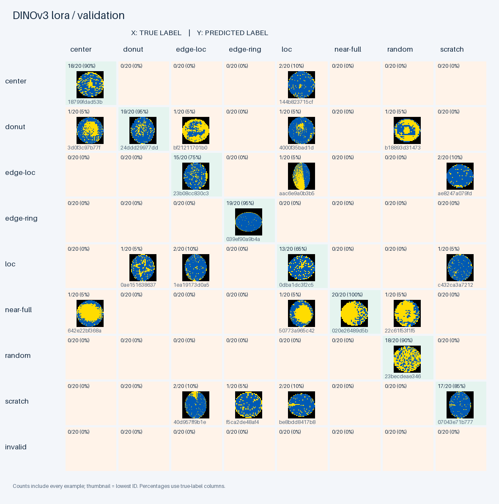
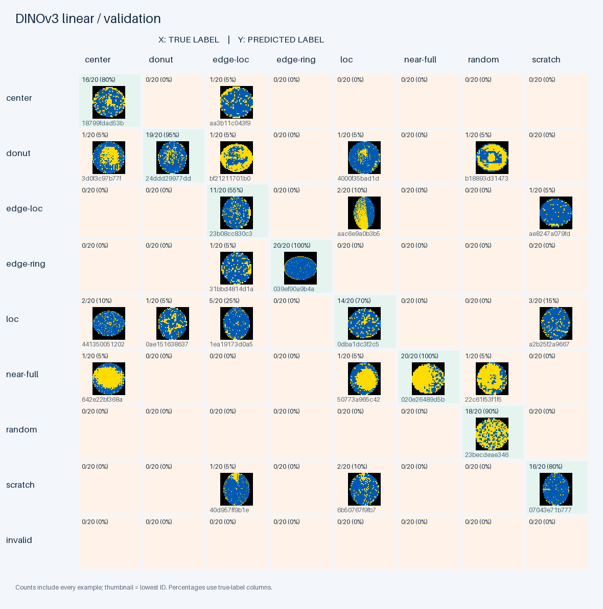
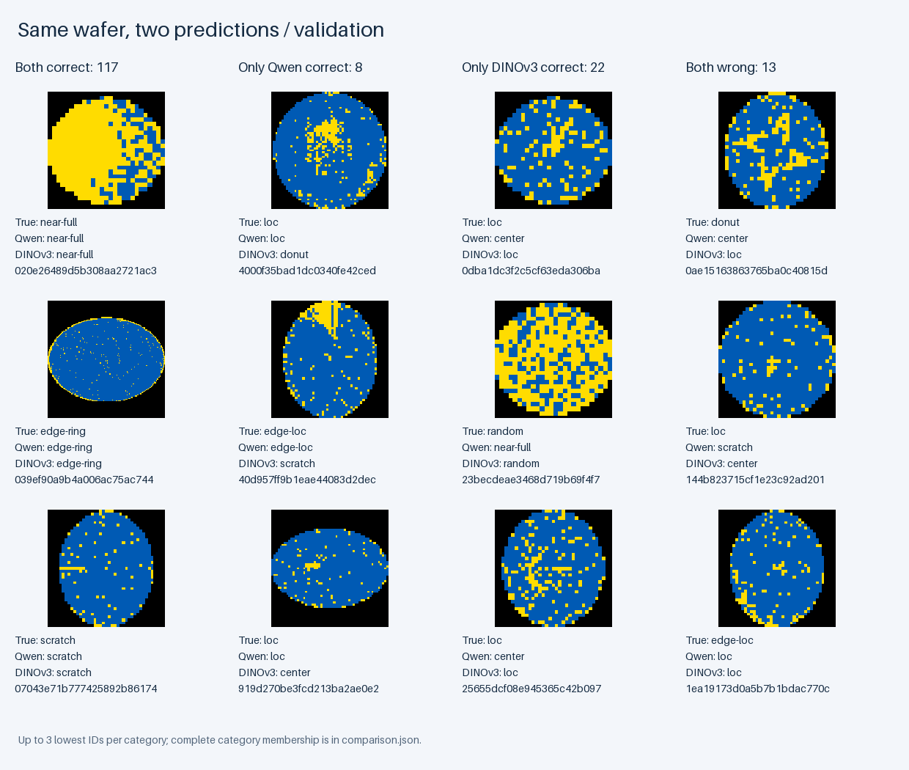

# DINOv3 seed-17 wafer-map showcase

These are recorded validation predictions from selected **LoRA trial `lora-1`, learning rate 0.0001, epoch 5**, from [run 43716864164](https://github.com/jasonjiang8866/waferVLM/actions/runs/43716864164). All 160 maps are included: **139 correct / 86.875% accuracy / 0.867173 macro-F1**. The original selected predictions use batch size 8; the separate reload predictions use batch size 1. Neither is a holdout result.

[Full experiment report](../../dinov3-seed17-results.md) · [Machine-readable provenance, all six histories and reload differences](../../evidence/dinov3-seed17-43716864164.json)

## Image confusion matrix



Every column has 20 maps. Cell percentages divide by that true-class total; teal marks correct predictions and orange marks mistakes. The invalid row is zero because this classifier chooses one of eight labels. Counts cover every validation prediction. Each thumbnail is the lowest sample ID in its cell, without confidence filtering. Colors: yellow=defective die, blue=good die, black=outside wafer.

## Accessible count table

**Rows = predicted; columns = true.** This transposes the true-first dictionaries in the raw metrics.

| Predicted \ True | center | donut | edge-loc | edge-ring | loc | near-full | random | scratch |
|---|---:|---:|---:|---:|---:|---:|---:|---:|
| center | 18 | 0 | 0 | 0 | 2 | 0 | 0 | 0 |
| donut | 1 | 19 | 1 | 0 | 1 | 0 | 1 | 0 |
| edge-loc | 0 | 0 | 15 | 0 | 1 | 0 | 0 | 2 |
| edge-ring | 0 | 0 | 0 | 19 | 0 | 0 | 0 | 0 |
| loc | 0 | 1 | 2 | 0 | 13 | 0 | 0 | 1 |
| near-full | 1 | 0 | 0 | 0 | 1 | 20 | 1 | 0 |
| random | 0 | 0 | 0 | 0 | 0 | 0 | 18 | 0 |
| scratch | 0 | 0 | 2 | 1 | 2 | 0 | 0 | 17 |
| invalid | 0 | 0 | 0 | 0 | 0 | 0 | 0 | 0 |

## Thumbnail sample IDs

Full IDs refer to the checksummed [validation manifest](validation.jsonl). The PNG shows abbreviated IDs.

| True label | Predicted label | Count | Thumbnail ID |
|---|---|---:|---|
| center | center | 18 | `18799fdad53b29b4db557d05` |
| loc | center | 2 | `144b823715cf1e23c92ad201` |
| center | donut | 1 | `3d0f3c97b77fd687704cb68a` |
| donut | donut | 19 | `24ddd29977dd60c0558df748` |
| edge-loc | donut | 1 | `bf21211701b00bf2d683bacb` |
| loc | donut | 1 | `4000f35bad1dc0340fe42ced` |
| random | donut | 1 | `b18893d3147303a9db15be3b` |
| edge-loc | edge-loc | 15 | `23b08cc830c3ddbda7d6c74a` |
| loc | edge-loc | 1 | `aac6e9a0b3b5aa660ce62121` |
| scratch | edge-loc | 2 | `ae8247a079fdea11649f1322` |
| edge-ring | edge-ring | 19 | `039ef90a9b4a006ac75ac744` |
| donut | loc | 1 | `0ae15163863765ba0c40815d` |
| edge-loc | loc | 2 | `1ea19173d0a5b7b1bdac770c` |
| loc | loc | 13 | `0dba1dc3f2c5cf63eda306ba` |
| scratch | loc | 1 | `c432ca3a7212596cf5768124` |
| center | near-full | 1 | `642e22bf368a2c29385b9a83` |
| loc | near-full | 1 | `50773a965c423a8290e617f2` |
| near-full | near-full | 20 | `020e26489d5b308aa2721ac3` |
| random | near-full | 1 | `22c61f53f1f5786e9fb394b8` |
| random | random | 18 | `23becdeae3468d719b69f4f7` |
| edge-loc | scratch | 2 | `40d957ff9b1eae44083d2dec` |
| edge-ring | scratch | 1 | `f5ca2de48af4e569a3ce1c2b` |
| loc | scratch | 2 | `be8bdd8417b86a07da6a61f2` |
| scratch | scratch | 17 | `07043e71b777425892b86174` |

## Linear baseline and paired examples

The selected frozen-backbone linear trial is `linear-1`, LR 0.003, epoch 10: **134/160 / 83.750% accuracy / 0.836449 macro-F1**.



The LoRA comparison with Qwen checkpoint 250 contains **117 both correct, 8 only Qwen correct, 22 only DINOv3 correct, and 13 both wrong**. Up to three lowest IDs per category are shown. Counts are preserved in [comparison-summary.json](comparison-summary.json); complete category membership and paired metrics are in [comparison.json](comparison.json). The corresponding frozen-linear comparison is in [linear-comparison.json](linear-comparison.json).



## Complete predictions and probabilities

All eight saved prediction sets are available directly in Git: the selected-epoch outputs from all six trials, plus both fresh-process reloads. Each file covers the **same 160 validation maps exactly once** (1,280 prediction records across eight files, not 1,280 distinct maps). These are the recorded selected-epoch outputs, not per-example predictions for every training epoch. No new inference was run for publication.

| Recorded output | LR | Selected epoch | Evaluation batch size | Complete JSONL |
|---|---:|---:|---:|---|
| linear-0 | 0.001 | 8 | 8 | [linear-0-predictions.jsonl](linear-0-predictions.jsonl) |
| **linear-1 (selected linear arm)** | **0.003** | **10** | **8** | [linear-predictions.jsonl](linear-predictions.jsonl) |
| linear-2 | 0.01 | 8 | 8 | [linear-2-predictions.jsonl](linear-2-predictions.jsonl) |
| lora-0 | 0.00005 | 6 | 8 | [lora-0-predictions.jsonl](lora-0-predictions.jsonl) |
| **lora-1 (selected LoRA arm)** | **0.0001** | **5** | **8** | [predictions.jsonl](predictions.jsonl) |
| lora-2 | 0.0002 | 6 | 8 | [lora-2-predictions.jsonl](lora-2-predictions.jsonl) |
| linear-1 reloaded | 0.003 | 10 | 1 | [linear-reload-predictions.jsonl](linear-reload-predictions.jsonl) |
| lora-1 reloaded | 0.0001 | 5 | 1 | [lora-reload-predictions.jsonl](lora-reload-predictions.jsonl) |

Each record retains its sample `id`, true `label`, `image_sha256`, predicted class, recorded response and eight class `probabilities`. Probability positions use this fixed label order:

```text
center, donut, edge-loc, edge-ring, loc, near-full, random, scratch
```

The probabilities sum to one within numerical tolerance, and the argmax class must agree with `prediction`. They are model softmax outputs, not a calibrated confidence guarantee. Join to [validation.jsonl](validation.jsonl) by sample ID and image hash. The manifest contains sample metadata and relative image paths, not image bytes; prepare the pinned dataset to resolve those paths.

The frozen Qwen comparison inputs remain in [the checkpoint-250 showcase](../checkpoint-250/predictions.jsonl). The [full report](../../dinov3-seed17-results.md#reload-verification-and-prediction-changes) documents the two linear and one LoRA prediction changes during reload. Keep selected and reloaded files distinct when recomputing a table or matrix.

## Provenance and reproduction

The three PNGs, eight prediction files, validation manifest and two complete comparison reports are copied byte-for-byte from the verified worker archive. Their SHA256 digests are in [checksums.json](checksums.json); the six trial and two reload prediction hashes also match the original manifests retained in [the experiment evidence](../../evidence/dinov3-seed17-43716864164.json). The publication retains the original values and row order. The [result ZIP](https://github.com/jasonjiang8866/waferVLM/actions/runs/43716864164/artifacts/14163676440) additionally contains selected weights and the complete training output.

To reproduce on CPU, prepare the pinned dataset as documented in the repository README, download and verify the [result ZIP](https://github.com/jasonjiang8866/waferVLM/actions/runs/43716864164/artifacts/14163676440) and nested archive against the report hashes, then use the extracted `results/lora-1` directory:

```bash
uv run --frozen python scripts/compare_dinov3.py compare \
  --dataset data/wm811k-lot17 --dinov3-result /path/to/results/lora-1 \
  --output outputs/dino-lora-seed17-showcase
```

Repeat with `results/linear-1` to regenerate the linear matrix. This renders existing predictions and runs no model inference. The raw dataset is not committed.
