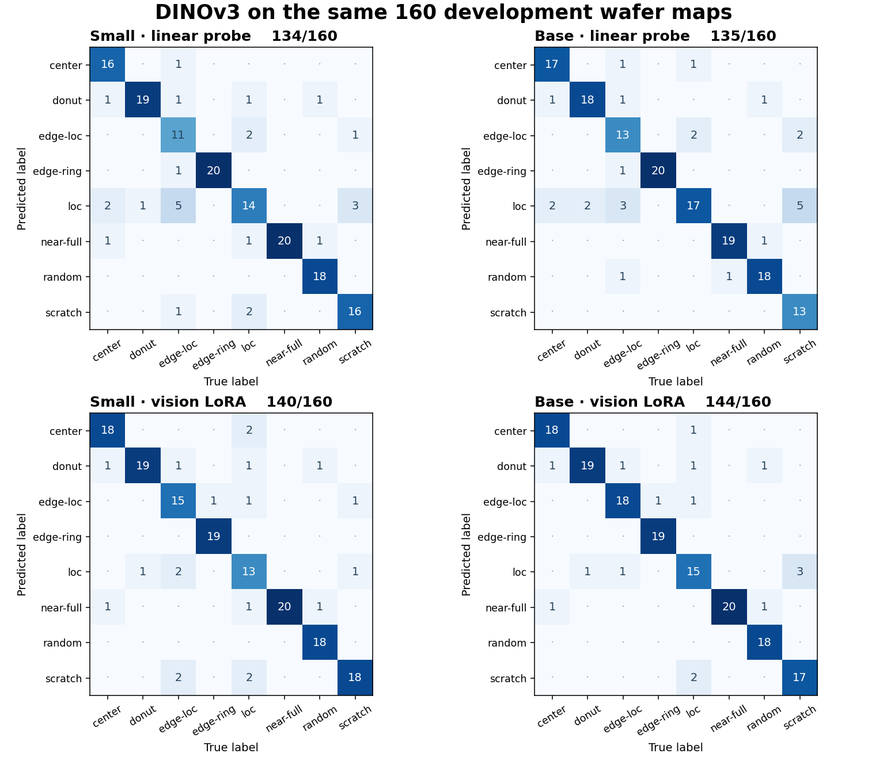

# DINOv3 size comparison on the development split

[GPU run 45728043478](https://github.com/jasonjiang8866/waferVLM/actions/runs/45728043478) trained four seed-17 classifiers on one RTX 4090. Each arm saw the same 790 maps for ten epochs. The table uses each arm’s earliest epoch at peak validation macro-F1 on the frozen 160 maps.

| Backbone and method | Correct / 160 | Macro-F1 | loc recall | Epoch | Training elapsed (s) | Peak allocated (MiB) |
|---|---:|---:|---:|---:|---:|---:|
| small-linear | 134 | 0.836449 | 70.0% | 10 | 84.1 | 135.7 |
| small-lora | 140 | 0.873125 | 65.0% | 5 | 102.3 | 429.4 |
| base-linear | 135 | 0.844989 | 85.0% | 9 | 83.7 | 401.0 |
| base-lora | 144 | 0.900338 | 75.0% | 10 | 105.1 | 1081.6 |

| Base versus Small | Both correct | Only Base correct | Only Small correct | Both wrong | Accuracy difference (pp) | Macro-F1 difference |
|---|---:|---:|---:|---:|---:|---:|
| linear | 125 | 10 | 9 | 16 | +0.625 | +0.008540 |
| lora | 138 | 6 | 2 | 14 | +2.500 | +0.027213 |

The prespecified primary contrast is Base-LoRA minus Small-LoRA. This pilot covers one seed on development images used for epoch selection. Cross-seed stability and unseen-lot performance require separate frozen evaluations.

The [paired rows](paired.csv) preserve all labels, predictions and image hashes. The four JSONL files include the original probabilities. The [CPU acceptance report](acceptance.json) includes the loc IDs rescued, newly missed and still missed, all class recalls and all four confusion matrices.

The [result artifact](https://github.com/jasonjiang8866/waferVLM/actions/runs/45728043478/artifacts/15076562290) includes the selected trainable weights. Original ZIP SHA-256 is `2d6e0c79ddee15a3314285b8cdfcee1094132875ba1955331127b6b6592ef8a4`.

## The 16 shared Qwen errors

All six published Qwen checkpoints missed these 16 development maps, including seven labeled loc. Sample ID, image hash and true label match for every map in the full split. This subset was selected using Qwen outcomes.

| Model | Common errors recovered / 16 | loc recovered / 7 |
|---|---:|---:|
| small-linear | 7 | 3 |
| base-linear | 8 | 5 |
| small-lora | 6 | 3 |
| base-lora | 7 | 4 |

The [sample table](qwen-common-errors.csv) includes all six Qwen labels and all four new predictions. [Original images and morphology notes](../dinov3-qwen-paired/README.md).

Across all four 4090 models, two of the seven shared Qwen loc misses persist. All four call `aac6e9a0b3b5aa660ce62121` edge-loc. Both linear probes call `c882bea412b6513af0935266` edge-loc and both LoRA models call it scratch.

## What changed for loc

| Adaptation | Both correct | Only Base correct | Only Small correct | Both wrong |
|---|---:|---:|---:|---:|
| linear | 13 | 4 | 1 | 2 |
| lora | 12 | 3 | 1 | 4 |

## Compute and cleanup

| Model | Trainable parameters | Mean inference throughput (images/s) |
|---|---:|---:|
| small-linear | 6,152 | 103.5 |
| base-linear | 12,296 | 115.7 |
| small-lora | 153,608 | 108.9 |
| base-lora | 307,208 | 123.3 |

The one-Pod lifecycle estimate is US$0.2795 for 18.66 minutes including startup and cleanup. The [independent cleanup](https://github.com/jasonjiang8866/waferVLM/actions/runs/45730513267) observed the owned Pod absent 12 consecutive times. Both receipts are in the [DINO ledger](../../../runpod/dinov3-study-ledger.json).
